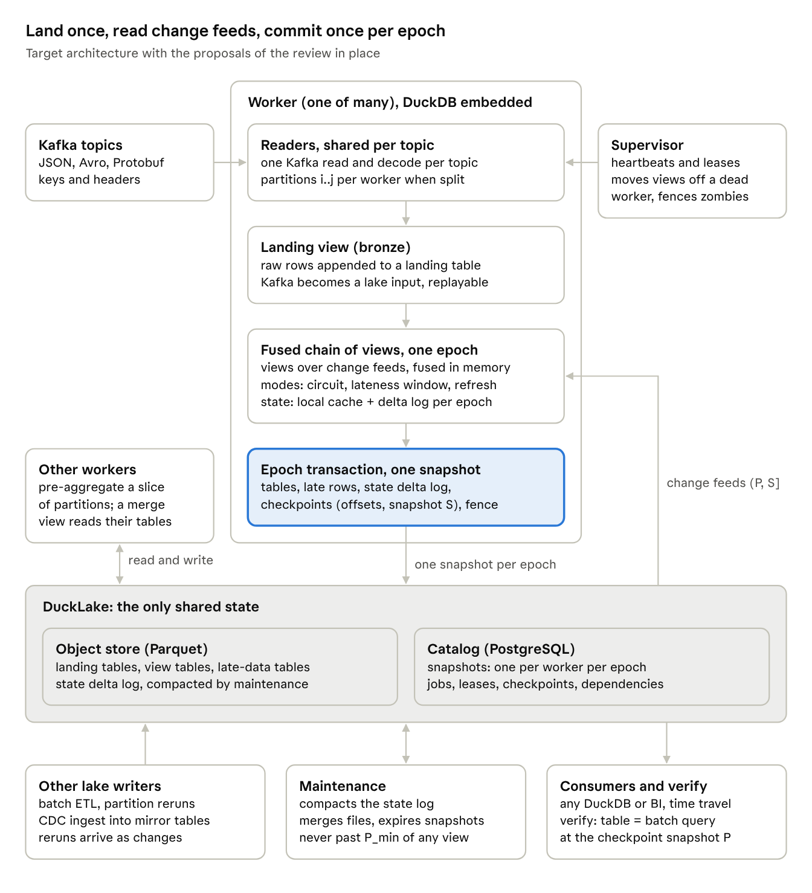

# Architecture review

Nov 11, 2026

DuckWake's defensible ground is exact, verifiable, incremental views in an open lake with a small footprint. Its weakest points are the catalog database on the hot path, state write amplification that nothing has measured, and scale-out by view only. Reviewed after F2 (commit `c6314b1`), from `docs/internals.md`, `docs/performance.md`, the test suites and the code.

## What the architecture is

A worker embeds DuckDB 2.0 with the lake attached. Each view is a DBSP circuit compiled to SQL per operator: staging (decode, windows, late split, partials) runs in the in-memory catalog, then one DuckLake transaction per worker per epoch writes every view's output, state, checkpoint and lease fence as a single snapshot. Kafka offsets and lake snapshot positions live in that checkpoint, so recovery is a seek.

Views read Kafka sources or any lake table or view through its change feed (F1, F2), with lookups against lake tables inside the epoch. `verify` recomputes any view as one batch query (Kafka history, or the lake at the checkpoint's snapshot) and compares multisets. Control data lives in `lake.__duckwake`; the catalog is PostgreSQL.

## Against other engines

DuckWake is the only one of these with a built-in correctness oracle and a single-transaction exactly-once; it is the slowest to react except the lakehouse refresh tools, and the only one that scales by view alone. Latency and throughput figures for DuckWake are measured (`docs/performance.md`); the others are from their documentation as remembered.

|  | DuckWake | Flink | Feldera | Materialize / RisingWave | Spark Structured Streaming | Lakehouse MV refresh (DLT, Snowflake DT, BigQuery) |
| --- | --- | --- | --- | --- | --- | --- |
| Model | micro-batch epochs, SQL per operator | per-record dataflow | DBSP, per batch | timely/differential, per record | micro-batch | periodic refresh, incremental when the planner can |
| Latency floor | 1–2 s + catalog commit (130–500 ms measured) | ms | ms to 100s of ms | ms | seconds | minutes |
| State | DuckLake tables (the lake is the state store) | RocksDB + checkpoints | memory, spill to disk | memory arrangements | state store on HDFS/RocksDB | none (recompute) or engine-internal |
| Exactly-once | one transaction over output, state, checkpoint, fence | checkpoint barriers + two-phase or transactional sinks | checkpoints; connector-dependent | internal; sinks mostly at-least-once | WAL + idempotent sinks | the table transaction |
| Scale-out | by view; one worker reads every partition | per-operator parallelism | single node | clusters / replicas | executors | warehouse |
| Failover | manual `start --worker` | automatic | process restart | automatic | driver restart | managed |
| Operator breadth | filter, project, lookup join, TUMBLE/HOP, global aggregate, DISTINCT, UNION ALL, chained views | broad, incl. stream–stream joins, sessions, CEP | broad SQL | broad SQL | moderate | any SQL, by falling back to a full refresh |
| Correctness oracle | `verify` | none | none | none | none | none |
| Footprint | a binary or a DuckDB extension + PostgreSQL + object store | a cluster | a binary | a cluster or cloud service | a cluster | a cloud service |

## Strengths

1. **Exactly-once without a protocol.** Output, state, checkpoint and fence commit in one DuckLake snapshot. Flink needs barriers plus transactional sinks; Spark needs idempotent sinks. A crash at any point leaves nothing to reconcile, and the crash suites prove it at every injection point.
2. **The lake is the state store.** Time travel gives `reset`, `verify`, exact watermarks for chained views and recovery with no savepoints. State is not bounded by memory.
3. **A principled incremental core.** The DBSP IR with a weight on every edge makes one plan correct for append-only and retracting inputs; Feldera's `dbsp` is a test oracle; a new operator is one file.
4. **A correctness oracle ships with the engine.** No other engine lets a user prove, after every epoch and through crashes, that a view equals its batch query. For a new engine this is the strongest trust asset it has.
5. **Streaming and lakehouse MVs in one engine.** Views over views and lake tables need no connectors. With F1 and F2, DuckWake is a lakehouse MV engine with second-level freshness and exact incremental semantics, which DLT, Snowflake dynamic tables and BigQuery MVs do not offer: they fall back to a full refresh.
6. **Footprint.** No cluster, no JobManager, no RocksDB. PostgreSQL plus object storage, and it runs inside DuckDB as an extension.

## Weaknesses, ranked

1. **The hot path runs through the catalog database.** Every epoch is a PostgreSQL transaction plus a DuckLake snapshot. That caps latency at seconds and ties throughput to catalog commit time (`commit_ms` 130–500 ms in the F2 runs). No other engine puts a catalog RDBMS inside every batch commit.
2. **Snapshot and metadata growth.** One snapshot per worker per epoch: at 1 s epochs about 86k per worker per day. Maintenance is mandatory, and DuckLake's conflict rule (any two writes to one table conflict) already shows as `flush inlined data` retries in the worker log.
3. **State write amplification, unmeasured.** Stateful operators rewrite touched state rows by delete + insert (DuckLake MERGE allows one action), with no indexes, every epoch. Flink and RocksDB do point updates; Feldera and Materialize keep state in memory. Nothing has measured a 1M-group aggregate or `DISTINCT` over 10M keys. This is the largest unknown in the design.
4. **Scale-out is by view only.** One worker reads every partition of a topic; there is no key-partitioned parallelism and no automatic failover. A single hot view has a hard ceiling (about 106k events/s stateless on a laptop, less when stateful).
5. **Windows are final.** Append-only input only, no re-fire within `lateness`, no session windows, per-partition maxima not checkpointed (the watermark stalls after a restart). A delete in a lake table stops every windowed view over it.
6. **Breadth.** Kafka JSON only; no stream–stream joins, no `HAVING` or `DISTINCT` in windows, no Avro/Protobuf, keys or headers, no CDC source yet; columns fixed at create time.
7. **Chained views add one epoch per hop**, and every lake-input view polls its change feed each epoch (one idle core for six views at 1 s epochs).
8. **DuckLake is young.** Format 1.1 bit the project six times (MERGE, conflicts, option visibility, inlining limits, reserved words, the `->` lambda). The lake-facing surface should stay small and pinned.
9. **No CI, plaintext Kafka, secrets in strings, no enforced memory limits.** All on the roadmap, none done.

## Proposed enhancements

First the three small items that unblock the rest, then four architecture-level proposals that are new to the plan, then the roadmap in the order to keep.

### Do now

- **CI** (P1). Everything below needs a safety net.
- **F4 shared and fused reads.** Removes the idle polling, collapses chain latency to one epoch, and is the prerequisite for proposals 1 and 2.
- **A state-heavy benchmark** before any state redesign: 1M groups, `DISTINCT` over 10M keys, recovery with 1 GB of state. Weakness 3 is a guess until this exists.

### Architecture-level

1. **Landing tables as the normal Kafka path.** One stateless append view per topic lands raw rows in the lake; every other view reads the landing table through its change feed. Gains: retention-independent `verify`, `reset` and replay; backfill for free (F3); one Kafka read and one decode per topic; Kafka becomes a special case of a lake input. Cost: one extra write and one hop, which F4's fusion removes. This is the bronze-layer pattern every lakehouse assumes, and it simplifies the engine.
2. **Scale-out by composition, not partition splitting.** A big aggregate becomes two views: per-worker pre-aggregates over a partition subset (needs only "a source reads partitions i..j"), merged by a view over their change feeds. Flink does this internally as two-phase aggregation; here it falls out of F1, F2 and F4 with no new runtime machinery.
3. **Append-only state log with compaction**, if the benchmark confirms write amplification. The epoch transaction writes only the state delta (appends inline and never conflict in DuckLake); the integrated state is a local cache rebuilt from the log since the last compaction, which maintenance writes. Exactly-once is unchanged, since the log is in the transaction. This is Flink's incremental checkpoint and Feldera's batches, mapped onto what DuckLake does well.
4. **A refresh fallback for SQL the circuit cannot incrementalize.** Generalize F5: a view DuckWake cannot compile incrementally still runs, by partition or whole-table recompute `AT (VERSION => S)`, with the same positions and transaction. This is DLT Enzyme's approach; it turns "unsupported SQL" from a refusal into a slower mode, and with the circuit it covers any SQL, the one dimension where the lakehouse tools beat DuckWake today.
5. **The `lateness` window sink**, then C4 behind it, then checkpointing per-partition maxima (see [Change feed sources](change-feed-sources.md), How other engines handle a change into a closed window). Together these close weakness 5 except session windows.

### Roadmap, order to keep

Failover (P2) → soak with the four flags on (P3) → schema evolution with `OR REPLACE` and additive columns (P4; the change feed already returns the new schema across `ADD COLUMN`) → connectors and breadth (CDC source, Avro/Protobuf, stream–stream joins).

### Positioning

DuckWake should not chase Flink on latency or breadth. Its defensible ground is exact, verifiable, incremental views in an open lake with a small footprint, where the competition is the lakehouse refresh tools, and against those it is already faster and more precise. Proposals 1 and 4 lean into that; per-operator parallelism would not.

## Micro-batch in seconds, against RisingWave

RisingWave is also an epoch engine: its barrier fires every 1 s by default, every barrier is a checkpoint, and results "lag behind the stream by at most one epoch". The difference is not batch against stream; it is what an epoch costs and where the output lands. Surveyed 2026-11-11 from RisingWave's documentation and blog (vendor-written, except one community post); sources at the end of this section.

|  | RisingWave | DuckWake |
| --- | --- | --- |
| Inside an epoch | continuous dataflow: actors pass row chunks, per-key state in Hummock (an LSM on S3 with a local cache) | set-at-a-time: the epoch's rows as one DuckDB query per operator |
| Epoch boundary | a barrier every `barrier_interval_ms` (default 1 s), Chandy-Lamport alignment, checkpoint on every barrier | `epoch_interval` (default 10 s; 1–2 s in the tests) |
| What a commit is | one MemTable flush per compute node into Hummock, metadata on the meta node; asynchronous, no RDBMS | one DuckLake transaction: Parquet or inlined rows plus a PostgreSQL catalog commit (130–500 ms measured) |
| Where results are served | its own materialized views over the PostgreSQL protocol, sub-second | the lake table itself, 1–2 s with short epochs |
| Lake output | Iceberg sink or table engine, committed every `commit_checkpoint_interval` checkpoints; their guidance is 60 s ("the right default"); readers see data "10 to 60 seconds" old | every epoch |
| Why the lake path is coarse | small files, 1,440 snapshots per day per table at 60 s, PUT costs, orphan files if a node dies between checkpoint and commit | the same forces, met every epoch |
| Consistency, exactly-once | MVs commit atomically with the checkpoint, no 2PC; an external sink gets epoch N after it is durable | one transaction over output, state, checkpoint, fence |
| Windows | emit on update (default) or `EMIT ON WINDOW CLOSE`; late data past the watermark is dropped | emit on close; late rows kept in a late table |
| Recovery | reads state from S3 directly, no download phase | the same, by design |

Two things stand out. RisingWave's epoch is cheap because it commits into its own store; the lake gets a coarser, decoupled copy. And within an epoch RisingWave already batches: its engineers call the barrier interval "the upper limit for batching", and all state writes of an epoch go out as one flush.

### Verdict on micro-batch in seconds

For what DuckWake is for, it is the right choice, and it is ahead today. A reader of the lake sees DuckWake's output 1–2 s after the event; RisingWave's recommended Iceberg path gives 60 s, its aggressive setting 10–15 s. Set-at-a-time processing is also the efficient shape for aggregates: an epoch consolidates inserts and deletes before they touch state, which Flink's mini-batch mode and RisingWave's in-epoch batching bolt on afterwards.

Where it is bad:

1. **Sub-second serving.** A need for 200 ms freshness makes DuckWake the wrong tool, and no epoch tuning fixes that. RisingWave answers it with a second serving path (pgwire to the MVs); DuckWake has none and should not pretend to.
2. **An epoch costs a catalog transaction.** RisingWave pays a MemTable flush; DuckWake pays PostgreSQL. One worker at 1 s epochs is measured and fine. Twenty workers is 20 snapshots/s into one catalog, and nobody has measured where that breaks (weakness 1).
3. **Point-update state.** Per-key random access to large state at low touch rates is where an LSM beats "delete + insert the touched rows every epoch". Unmeasured (weakness 3).

### Should DuckWake do what RisingWave does?

No to the engine, yes to three ideas it validates.

Not copied: the per-record dataflow, the actor runtime, Hummock, the meta node, the compactor fleet. That is RisingWave's whole company, it would replace DuckDB as the compute engine, it contradicts the thesis that the lake is the only shared state, and it would end the single-transaction exactly-once. Also not copied: a log store for sink decoupling. RisingWave needs one because its sink is downstream of its own store; for DuckWake, Kafka is the buffer, and after proposal 1 the landing table is the lake-side one.

Copied:

1. **Per-epoch state writes as appends, compacted in the background.** RisingWave's shared buffer, one SST per epoch and remote compaction is the shape of proposal 3 (append-only state delta log, local cache, maintenance compacts). Their design is the evidence that the pattern works on object storage. Build it if the state benchmark shows write amplification.
2. **`epoch_interval` as the explicit freshness-against-cost knob, with guidance.** RisingWave publishes "monitoring 15–30 s, dashboards 60 s, analytics 5–15 min" for its lake commits. DuckWake should publish the same table for `epoch_interval`, with the cost per epoch beside it (snapshots per day, catalog rows, files before maintenance). 10 s stays the default; 1 s is for a few hot views, not the fleet.
3. **Measure the catalog ceiling.** Add to the P3 soak: N workers at 1 s epochs against one PostgreSQL, until commit latency or conflicts climb. That number decides whether proposal 1 should also coalesce commits.

Sources: trigger mechanism: barriers as a batching bound · checkpoint design doc · fault tolerance · system parameters · Flink vs RisingWave exactly-once (vendor) · how often to commit to Iceberg · real-time lakehouse architecture · Iceberg table engine · sink consistency (community) · emit on window close · Hummock

## Target architecture

Kafka lands once in a landing table (proposal 1) and every view, the merge views of other workers included (2), reads a change feed. The epoch transaction writes tables, the state delta log (3) and the checkpoint as one snapshot. A view runs as a circuit, a `lateness` window sink (5) or a refresh fallback (4). The supervisor keeps views on live workers; maintenance compacts the log and expires snapshots, never past the oldest position a view still needs.
