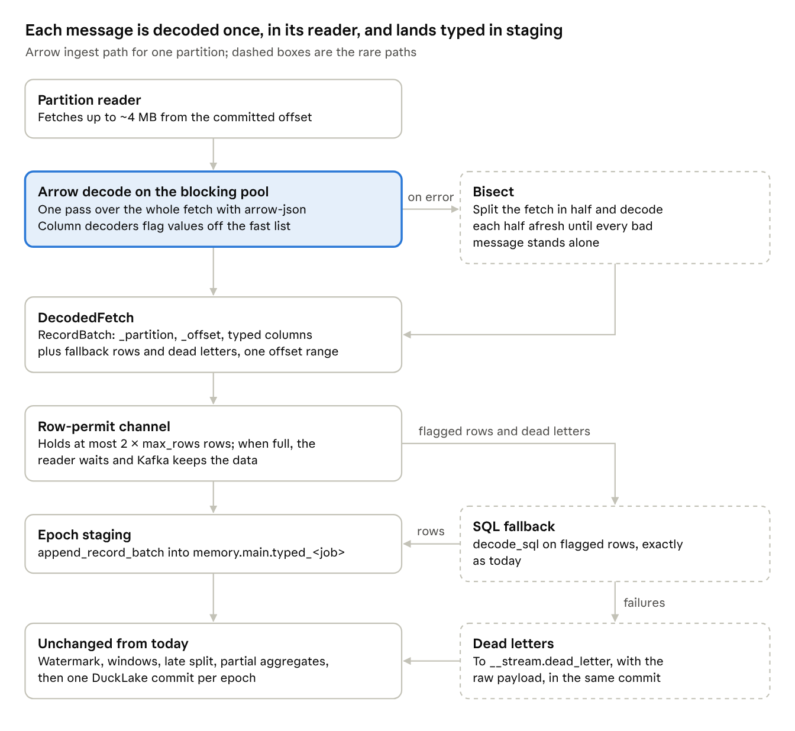
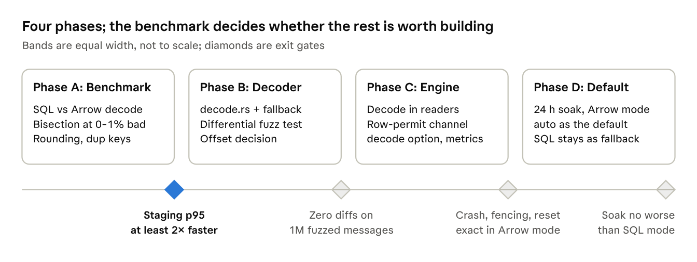

# Arrow ingest plan

Oct 29, 2026

DuckWake will decode Kafka JSON once, in Rust, into typed Arrow batches and append them to each epoch's staging table with `append_record_batch`. This replaces today's per-column JSON parsing in SQL. It ships behind a per-source `decode` option and becomes the default only after it matches the SQL path on the exactly-once suite and beats it on the throughput test.

## Status

Phases A and B are done, and `decode: auto` (Arrow when every column type allows it) is the default. The sections after this one are the original plan. The code differs from it in two places, noted below.

- **Phase A:** Arrow decode was 4–5.6× faster than the SQL decode, with 0 differences on the hostile corpus.
- **Phase B:** readers decode in Rust. Fast-list forms go to Arrow, everything else to `decode_sql`, and bisection isolates bad messages. Checkpoints record `rows_sql`, and the playground has a decode selector.
- **`decode_test.sh` passes:** one hostile topic read by a SQL source and an Arrow source gives identical sinks and dead letters, and both verify.
- **A/B at 20k events/s:** see the table below.

| Measure at 20k events/s | SQL decode | Arrow decode |
| --- | --- | --- |
| Poll + stage per epoch | 535 ms | 366 ms |
| Commit per epoch | 868 ms | 756 ms |
| Lag | 20–29k | 18–22k |
| Freshness p50, by view | 0.19–0.59 s | 0.16–0.42 s |

Differences from the plan:

- Readers cut each fetch into chunks of `clamp(max_rows / 8, 64, 4096)` messages instead of passing whole fetches.
- Backpressure counts messages (`2 × max_rows` permits), not channel slots. A first version bounded the channel by chunk count, and readers stalled at 20k events/s.

Left to do: run `crash_test`, `fencing_test`, `reset_test` and `retention_test` in Arrow mode, run `catchup_test.sh`, and a 24 h soak in Arrow mode (Phase D).

## Why: staging costs more than the commit

At 5,000 events/s, turning a 10 s epoch's Kafka messages into typed rows now takes longer than committing them. The cost is JSON parsing in SQL, repeated per column.

| Measurement (50k events of \~1 KB per epoch) | Poll + stage | Commit | Source |
| --- | --- | --- | --- |
| Throughput test, idle machine | \~0.45 s | \~0.15 s | `scripts/throughput_test.sh` |
| Soak, first 48 min, p95 | 1.4 s | 0.55 s | `scripts/soak_report.sh` |
| Soak smoke run, worst minute, p95 | 2.3 s | 0.9 s | `.lake/soak_smoke` |

Today each message takes this path (`engine.rs::stage`, `plan.rs::decode_sql`):

1. The raw payload is copied into DuckDB as a `VARCHAR`, row by row through the appender, into `raw_<job>`.
2. `json_valid` and `json_type` split off non-objects; the survivors are copied again into `ok_<job>`.
3. For N declared columns, the decode query calls `json_extract_string` up to 3N + 1 more times per event: once for the value and twice per column for the type-conflict check. DuckDB's common-subexpression pass may merge some of these.
4. Each job repeats steps 1–3 for its own copy of the messages, so two views on one source decode every event twice.

With the soak's 4 columns that is up to 15 JSON function calls and two full copies of every 1 KB payload, per job, per event. Decoding once into typed columns removes the repeated parsing and both copies.

## Target design: decode once, in the reader

The new work is the decode step and what it hands over; staging from `typed_<job>` onward is today's code. The rare paths (bisection, the SQL fallback and dead letters) keep every message accounted for without slowing the common case.

## Decode semantics: an Arrow fast path with an exact SQL fallback

The Arrow decoder must not change a single sink row. A value it can't decode unambiguously falls back to today's SQL decode, so results match the SQL path exactly, and the fallback stays cheap because such values are rare.

The two decoders disagree today, as checked against DuckDB v2.0.0 casts and the `arrow-json` 60.0.0 source:

| Input | Today: SQL decode | `arrow-json` as shipped | Plan |
| --- | --- | --- | --- |
| Malformed or truncated JSON | Dead letter `invalid json` | Stream error; a truncated message can swallow the next one | Dead letter, with a per-message boundary check (next section) |
| Valid JSON, not an object | Dead letter | Error (`ObjectOnly`) | Dead letter |
| Field missing or `null` | NULL | NULL | NULL; a missing event time is a dead letter |
| Field not in the source's columns | Ignored | Ignored (strict mode off) | Ignored |
| Number or boolean into `VARCHAR` | Its text, `"5"` | Conflict unless `coerce_primitive` | Fast path with `coerce_primitive` on |
| Object or array into `VARCHAR` | Its JSON text | Conflict | Fallback to SQL |
| `"12.345"` into `DECIMAL(18,2)` | 12.35 (rounds) | `parse_decimal`; rounding not yet confirmed | Fast path only if Phase A confirms rounding matches, else fallback |
| `"1.5"`, `"1e2"` or `" 42 "` into `BIGINT` | 2, 100, 42 | String parse fails | Fallback to SQL |
| JSON number `1.5` into `BIGINT` | 2 | Truncates to 1 | Fallback to SQL; the fast path accepts integers only |
| `"yes"` or `"1"` into `BOOLEAN` | true | Conflict | Fallback to SQL |
| Number into `TIMESTAMP` | Dead letter | Read as epoch microseconds | Fallback to SQL, which dead-letters it |
| `"2026-10-29 06:02:50+07:00"` into `TIMESTAMP` | Offset silently dropped: 06:02:50 | Converted to UTC: 23:02:50 the day before | Fallback to SQL for now; see the decision below |
| Duplicate key | First value wins | Last value wins | Fallback to SQL when a row has duplicate keys |

The fast path is `arrow-json` with `coerce_primitive` and `ignore_type_conflicts` on, and a `DecoderFactory` that wraps each column decoder. The wrapper flags a row whenever the tape holds a non-null value but the decoder produced NULL, or the value's form isn't on the fast list for that type. Flagged rows keep their raw payload and go through the existing SQL decode, which decides value or dead letter exactly as today.

Supported fast-path types: `TIMESTAMP`, `DATE`, `VARCHAR`, `BOOLEAN`, the integer types, `DOUBLE` / `FLOAT` and `DECIMAL(p,s)` with p ≤ 38. A source with any other column type, such as nested types or `VARIANT`, uses the SQL decode for every row.

**Decision needed:** dropping a timestamp's offset is a bug in today's decode, not a feature to preserve. The proposal is to convert offsets to UTC in both paths, as a separate, announced change, before the Arrow path ships. Until then such values fall back to SQL.

## Bad records: decode optimistically, bisect on failure

Every message must end up as exactly one typed row or exactly one dead letter, in offset order, on every replay. `arrow-json` decodes a byte stream, not a list of messages. That gives three ways for one bad message to hurt its neighbours:

- **A hard error** (`decode` or `flush` returns `Err`) loses every row buffered in that decoder.
- **A truncated message** such as ` {"broken":  ` can absorb the next message as a nested value. That leaves either an error or a partial record.
- **A merge that still parses:** two messages become one row, with no error at all.

The decoder handles them like this:

1. **Optimistic pass.** Feed all messages of a fetch (up to \~4 MB) into one decoder, each followed by a newline. Then flush.
2. **Detect.** The pass is clean only if `decode` and `flush` both succeed, no partial record remains, and the batch's row count equals the number of messages. The last check catches silent merges.
3. **Isolate.** If the pass isn't clean, split the messages in half and decode each half with a fresh decoder, recursively. A range of one message that fails is a dead letter: `invalid json` or `not a JSON object`, with its raw payload.
4. **Adapt.** Bisection costs about k · log₂ n extra decodes for k bad messages in n. Once a partition's bad rate passes a threshold (proposed: 1% over the last 10 fetches), its reader switches to checking every message first with a fast structural pass. It switches back when the rate falls.
5. **Route.** Rows flagged by the type wrapper (previous section) carry their payload to the SQL fallback. Rows with a NULL event time become dead letters `missing or invalid event time`, as today.

**Invariant, asserted per fetch:** typed rows + fallback rows + dead letters = messages, and their offsets are exactly the fetch's offset range. A violation fails the epoch, so the worker restarts from the last checkpoint instead of committing a wrong batch.

Decoding is pure: the same messages always give the same rows and the same dead letters. A replay after a crash therefore reproduces the exact staging input. The only exception is that the adaptive switch in step 4 changes how a bad message is found, never what it decodes to.

## Threads and backpressure: decode in the readers, bound by rows

Decoding moves out of the epoch thread and into the partition readers. The CPU work then overlaps with the previous epoch's staging and commit, as the design intends for polling, and it runs on as many cores as there are partitions.

- **Where it runs:** each partition reader fetches as today. It then hands the fetch to a blocking pool (`spawn_blocking`), never decoding on the async runtime's threads. A fetch decodes into one `DecodedFetch`: a `RecordBatch` of `_partition`, `_offset` and the source's columns, plus fallback rows and dead letters, all tagged with the fetch's offset range.
- **What the channel carries:** `DecodedFetch` values instead of single messages. Order within a partition is preserved because a reader decodes its fetches one after another.
- **Backpressure by rows, not messages:** a semaphore of `2 × max_rows` row permits replaces the fixed channel capacity. A reader acquires permits for a fetch's rows before sending it; the epoch releases them once it has staged the batch. A slow epoch therefore stalls the readers, and Kafka keeps the data.
- **Epoch drain:** the epoch takes whole `DecodedFetch` values until it reaches `max_rows`, so `max_rows` becomes a soft cap that one fetch (\~4 MB) can exceed. The committed offset per partition is the end of the last fetch taken. Never splitting a fetch keeps dead letters and rows of one offset range together.
- **Into DuckDB:** the epoch concatenates the batches and calls `append_record_batch` into `memory.main.typed_<job>`, the table today's decode SQL produces. Fallback rows go through today's decode SQL and are appended to the same table. Everything after that (watermark, windows, late split, partial aggregates, commit) is unchanged.
- **Memory:** the channel now holds typed columns, not raw payloads. With the soak's schema that is a timestamp, two short strings and a decimal per row instead of \~1 KB of text. The same row budget then holds about an order of magnitude fewer bytes (an estimate, to be measured in Phase A).

Two options stay open until Phase A measures them:

- **Scanning in place** through the `arrow` table function (`vtab-arrow`) instead of copying with the appender. The copy is likely cheap next to decoding, and staging reads the table several times, so the plan starts with the appender.
- **Sharing one decode** between jobs that read the same source. This needs a shared reader with per-job cursors, so it's a follow-up, not part of this plan.

## Changes by module

Most of the work is one new module, `decode.rs`. The engine change is limited to where staging gets its typed rows; nothing from the watermark onward changes.

| File | Change |
| --- | --- |
| `Cargo.toml` | Add the `appender-arrow` feature to `duckdb`, and `arrow-json = "60"` at the same major version as DuckDB's `arrow`. |
| `crates/core/src/model.rs` | New source option `decode`: `sql`, `arrow` or `auto` (the default). `auto` picks Arrow when every column type is on the fast-path list. |
| `crates/core/src/decode.rs` (new) | DuckDB-to-Arrow type mapping. Decoder construction: `coerce_primitive`, `ignore_type_conflicts`, and the conflict-flagging `DecoderFactory`. Optimistic pass, detection, bisection and the adaptive check. Returns `DecodedFetch`. |
| `crates/core/src/kafka.rs` | Readers decode each fetch on the blocking pool. The channel carries `DecodedFetch`, behind a row-permit semaphore. |
| `crates/core/src/engine.rs` | `stage` takes `DecodedFetch` values. It appends typed batches with `append_record_batch`, runs fallback rows through `decode_sql`, and merges dead letters. The epoch log line gains `decode_ms`, `fallback_rows` and `bisections`. |
| `crates/core/src/plan.rs` | `decode_sql` stays and becomes the fallback. Its CASE checks gain an explicit `not a JSON object` reason. |
| `crates/core/src/verify.rs` | Recomputes through the job's own decode mode, plus a mode that decodes the same messages both ways and compares them. |
| `crates/core/src/adhoc.rs` | Source snapshots use the same decoder, so `SELECT * FROM clicks` matches what views see. |
| `crates/duckwake/src/playground.*` | Show the decode mode on the source page, and fallback and bisection counts per epoch. |
| `crates/core/benches/decode.rs` (new) | Criterion benchmarks: SQL decode vs. Arrow decode + append, on the soak's event shape and on a hostile corpus. |

## Rollout: four phases, each behind a gate

Phase A is a short spike that can stop the work cheaply. If Arrow decode plus append doesn't make staging at least 2× faster at p95 on the soak's event shape (a proposed bar), the SQL path stays and the plan ends there. The other gates come from the tests above. The SQL decode is never removed: it remains the fallback and the `decode: sql` escape hatch. The Phase A benchmark and the Phase C and D engine runs compete with the running soak for CPU and the shared lake, so they wait for it to end (Oct 30, 07:20 UTC). Phase B is code and in-memory tests and can start now.

## Testing and benchmarks

The Arrow path is correct only if it agrees with the SQL path on every input. The main test therefore decodes the same messages both ways and requires identical output.

- **Differential decode test.** A property-based generator (`proptest`) builds message sequences from four pools: clean events, every row of the semantics table, random byte mutations (truncation, bit flips, deleted quotes), and concatenation hazards like a truncated message followed by a valid one. Both decoders run on each sequence. Typed rows and dead letters (offset, reason, payload) must match as multisets. It runs in CI with a fixed seed and nightly with a fresh one.
- **Invariant tests for `decode.rs`.** Rows + fallbacks + dead letters = messages. Offsets are contiguous and ordered. Bisection gives the same result as decoding one message at a time.
- **Exactly-once suite in both modes.** Run `crash_test.sh`, `fencing_test.sh` and `reset_test.sh` with `decode: arrow`, and once with a source switched from `sql` to `arrow` between epochs. Every run must end with `verify` exact.
- **Micro-benchmark (Phase A).** On 50k events of the soak's shape, time today's SQL decode against Arrow decode + `append_record_batch`, and against a scan in place. Repeat at 0%, 0.02% and 1% malformed to price bisection and the adaptive check.
- **Throughput and soak.** Re-run `throughput_test.sh` and a 24 h soak in Arrow mode. Compare per-epoch staging p50 and p95, worker CPU and RSS, and lag against the current SQL-mode soak, which is the baseline.

## Risks and open questions

| Risk | Likelihood | Mitigation |
| --- | --- | --- |
| The fast path accepts a form the SQL path treats differently, so sink rows change | Medium | Narrow fast-path list, SQL fallback, and the differential test as a merge gate |
| Detecting duplicate keys needs a scan of each object's keys, which may cost more than it saves | Medium | Measure in Phase A; if too costly, adopt "last value wins" as an announced change |
| `arrow-json`, `duckdb`'s `arrow` and `duckdb-neo` drift apart in major version | Medium | Pin all three to one Arrow major; the decoder is behind `decode.rs`, so the SQL path remains if a pin breaks |
| Bisection becomes expensive on sources with many bad messages | Low | Adaptive per-message check; a dead-letter rate alert already exists in the design |
| Decoding in readers raises peak memory when many fetches queue | Low | Row-permit semaphore bounds queued rows; Phase A measures bytes per row |
| A staging speed-up doesn't change end-to-end latency much, since epochs are 10 s | Low | The win is CPU headroom per worker (more jobs or higher rates), measured in the soak |

**Open questions**

- [ ] Convert timestamp offsets to UTC in both paths before Arrow ships (proposed), or keep dropping them?
- [ ] Keep `_payload` for every row in source snapshots, at the cost of the copy Arrow avoids, or only for fallback rows and dead letters?
- [ ] Should `decode: auto` become the default for new sources only, or also for existing ones after Phase D?
- [ ] Avro and Protobuf sources would decode straight into Arrow too. Do they come next, reusing `decode.rs`, or after the shared per-source reader?
