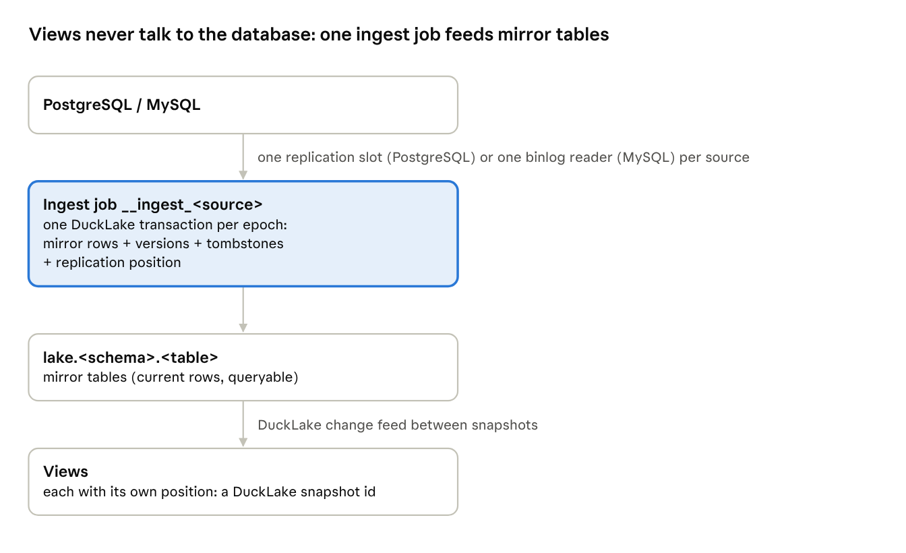

# Database CDC sources

Nov 5, 2026

DuckWake will read PostgreSQL and MySQL changes directly, without Kafka or Debezium, through native Rust connectors. Each database source is ingested by one job into mirror tables in the lake, committing the rows and the replication position in one DuckLake transaction, so ingestion is exactly-once; views then read the mirror tables' changes like any other lake table. This builds on [CDC sources](cdc-sources.md) (keyed upserts, versions, one current-row table per source) and spike S6 (lake tables as sources).

## Options compared

Native Rust connectors are the only option that commits the replication position in DuckWake's own epoch transaction; every reusable tool keeps its position somewhere else.

| Option | What it is | Fit with one-transaction exactly-once | Verdict |
| --- | --- | --- | --- |
| OLake | Go, Apache-2.0; PostgreSQL (pgoutput), MySQL (binlog), MongoDB; writes Iceberg (through a Java sidecar) or Parquet | Runs as bounded batch syncs up to the WAL head, commits per table with its position in an Iceberg property, keeps state in its own JSON file; no DuckLake output | Not as a library or subprocess. Possible as a one-off bulk loader into Iceberg. Many design ideas worth copying (below). |
| supabase/etl | Rust, Apache-2.0, version 0.1 from git; embeddable with your own destination | At-least-once by design; checkpoint in its own state store, separate from the destination write | No: the checkpoint would have to move into our commit, which its architecture does not allow |
| Embedded Debezium (as RisingWave does, through JNI) | Debezium's Java engine inside the worker | Positions in Debezium's offset store; a JVM in every worker | No |
| Native Rust connectors | pgoutput over the replication protocol (MaterializeInc/rust-postgres fork, pinned; pg\_walstream as a crates.io fallback); MySQL binlog with mysql\_async (`binlog` feature), which Materialize uses | Position stored in the epoch transaction; the slot is acknowledged only after that commit | Yes |

What to copy from OLake: the source position committed with the data and the slot acknowledged only after the commit; keepalives answered with the old confirmed LSN so a long commit does not drop the connection (its issue #1308); deterministic chunk IDs recorded in the commit so a backfill resumes idempotently; snapshot chunks sized from heap and TOAST bytes and aware of partitions. What not to copy: the message's WAL start as a row's version (use the commit LSN), ignoring the old key when a primary key changes (#1363), and snapshot chunks without a common consistent snapshot.

## Architecture

A database source is ingested once, by its own job, into mirror tables; views never talk to the database.

**The ingest job** is a job like a view: it has a lease and fencing, runs on one worker, and recovers from its checkpoint. Each epoch it reads whole source transactions, applies them as keyed upserts ([CDC sources](cdc-sources.md)): one winner per key by version, tombstones for deleted keys, unchanged TOAST values filled from the stored row. It writes the mirror tables and the replication position in one DuckLake transaction, and acknowledges the slot afterwards.

**Views read the mirror tables** as lake-table sources (spike S6). DuckLake's change feed between two snapshots gives inserts (+1), deletes (−1) and updates as pre-image (−1) and post-image (+1), so a view gets an exact Z-set without any CDC logic of its own. A view's position is the last DuckLake snapshot it read, stored in its checkpoint like a Kafka offset.

**Why one ingest job rather than a slot per view.** A slot has one confirmed position, but views sit at different positions: a view created later starts from the beginning, a reset one goes back, a paused one waits. A slot per view would multiply the WAL the database retains and the load on its primary. With the mirror, the slot follows one job, and each view moves through lake snapshots independently; this is also the one-table-per-source decision of [CDC sources](cdc-sources.md).

**Costs.** Two hops instead of one: a change reaches a view one ingest epoch plus one view epoch after its commit, about 2 s at 1 s epochs. Maintenance must keep the DuckLake snapshots that the slowest view still needs, as it keeps Kafka retention in mind today. In return the user gets a queryable replica of each source table in the lake, and Kafka-borne CDC (Debezium and upsert topics) can take the same path.

## PostgreSQL

The ingest job reads `pgoutput` (protocol version 1, no streaming of in-progress transactions) from one logical replication slot and one publication. Exactly-once rests on six rules:

1. **Whole transactions only.** An epoch ends after a `Commit` message; a transaction is never split across epochs, so the mirror never shows half of one.
2. **The position is the last transaction's `Commit.end_lsn`,** stored in the epoch's DuckLake transaction with the mirror rows. An epoch with no transactions may store the keepalive's `wal_end`.
3. **Acknowledge only what has committed.** A standby status update carries write = flush = apply = the stored position, sent only after the DuckLake commit, and repeated at least every `wal_sender_timeout` / 2 by a timer of its own, so a long commit never drops the connection (OLake's issue #1308). A received but uncommitted LSN is never acknowledged.
4. **Restart from the lake, not the slot.** Read the stored position; if the slot's `confirmed_flush_lsn` is ahead of it, changes are lost and the source fails, asking for a fresh snapshot. Otherwise `START_REPLICATION` at the stored position and skip every transaction whose `Begin.final_lsn` is below it: the slot may resend from an older point after a database crash, and the PostgreSQL docs tell clients to skip by LSN.
5. **Version per row: (`commit_lsn`, ordinal within the transaction).** It orders all changes of a key, makes redelivery idempotent, and is what the upsert step compares; snapshot rows get (snapshot LSN, 0).
6. **Old rows and TOAST.** With the default `REPLICA IDENTITY`, an update carries the old key only when the key changed ('K' tuple) and leaves unchanged TOAST columns out ('u'). The ingest job handles both from the stored row: a changed key deletes the old key and inserts the new one, and 'u' columns take the stored value. `REPLICA IDENTITY FULL` is therefore not required. `TRUNCATE` deletes every row of the table.

Permissions: a role with `REPLICATION` and `SELECT` on the tables, and `wal_level = logical` on the server. The job can create the publication and the slot, or use ones the user created (`"publication"`, `"slot"` options).

## MySQL

The ingest job reads the binlog with `mysql_async`'s binlog stream, positioned by GTID set.

1. **Server settings required:** `binlog_format = ROW`, `binlog_row_image = FULL` (MINIMAL leaves columns out of both images), `gtid_mode = ON` and `enforce_gtid_consistency = ON`; `binlog_row_metadata = FULL` recommended, for column names.
2. **The position is the executed GTID set** as of the last complete transaction (its `Xid` event), stored in the epoch's DuckLake transaction. Nothing is acknowledged to MySQL.
3. **Resume** with the stored set: the server skips every transaction already in it, so nothing is redelivered. If `@@gtid_purged` is not a subset of the stored set, the binlog needed is gone and the source fails, asking for a fresh snapshot.
4. **Version per row:** GTIDs from several servers are not totally ordered, so the job versions rows with its own durable sequence number in binlog order, kept in the checkpoint.
5. **DDL** arrives in the binlog as query events; the job tracks each table's columns from them and stores the schema with the position, as OLake does.

The risk differs from PostgreSQL's: MySQL never waits for the reader, so a source paused longer than `binlog_expire_logs_seconds` (30 days by default) loses its position rather than filling the server's disk.

## Initial snapshot

The snapshot and the stream meet at one exact position, and the snapshot is read in parallel under one consistent view of the database.

- **PostgreSQL.** Create the slot with `EXPORT_SNAPSHOT`: it returns the `consistent_point` LSN and a snapshot name. Several sessions import that snapshot (`SET TRANSACTION SNAPSHOT` in a `REPEATABLE READ` transaction) and copy chunks in parallel, all seeing the database exactly as of the slot's start. Chunks are `ctid` page ranges sized from heap and TOAST bytes, or primary-key ranges, as OLake chooses them, but under one shared snapshot rather than one transaction per chunk. Snapshot rows are written as upserts at version (snapshot LSN, 0); streaming then starts at the slot's start, and no change is lost or applied twice.
- **MySQL.** Lock the tables, read `@@gtid_executed`, start `WITH CONSISTENT SNAPSHOT` transactions, unlock, then copy in parallel by primary-key ranges; streaming resumes from that GTID set. The lock is held only while the transactions start.
- **Progress.** Each committed chunk's deterministic ID (table plus range) goes into the epoch's DuckLake transaction, so a resumed snapshot skips chunks already written. A PostgreSQL exported snapshot does not survive its connection, so a snapshot interrupted by a crash restarts from a new slot; chunks are idempotent upserts, so restarting costs time, not correctness.
- **Very large tables.** A DBLog-style backfill (low watermark, chunk, high watermark, as Flink CDC and RisingWave do) avoids one long snapshot transaction and survives crashes chunk by chunk. It is a later step, for tables whose snapshot takes longer than the WAL the server can keep.
- **Adding a table** to a running source snapshots that table alone, at a new position, while the others keep streaming.

## Schemas, types and operations

- **Declaring a source.** `duckwake_create_source('shop', 'postgres', '{"dsn": ..., "tables": ["public.orders", "public.customers"], "publication": ..., "slot": ...}')` creates the ingest job and a mirror table per captured table, e.g. `lake.shop.orders`. Views read the mirror table by name; it is a lake table, so lookups and lake-table sources treat it alike.
- **Keys.** Each mirror table takes the source table's primary key, which keyed upserts need. A table without one is refused unless it is append-only and declared so, or has `REPLICA IDENTITY FULL` and the user opts in to `trust_before`.
- **Types.** `pgoutput` sends values as text, which DuckDB casts to the mirror column's type, the same way the Kafka JSON decode casts fields today; the mapping from PostgreSQL and MySQL types to DuckDB types is fixed when the source is created. Values that fail to cast go to the dead-letter table with the change's position.
- **Schema changes.** PostgreSQL sends a `Relation` message before the first change after a table's columns change; MySQL logs the DDL. v1 applies an added nullable column to the mirror table (DuckLake supports adding columns) and stops the source with a clear error for anything else, rather than guessing.
- **Secrets.** The connection string is read from a secret reference, not stored in the source definition (production roadmap P2).
- **Monitoring.** Per source: lag in bytes (server LSN minus committed position) and seconds, epoch commit time, rows per table, and for PostgreSQL the slot's `wal_status` and `safe_wal_size`, which warn before a lagging slot fills the server's disk or is invalidated. `max_slot_wal_keep_size` defaults to no limit, so the docs should recommend setting it.

## Milestones

The mirror path needs two things from other plans first: operators that handle −1 ([CDC sources](cdc-sources.md), C1) and lake tables as sources (spike S6).

1. **D1. PostgreSQL ingest job.** Slot and publication handling, the six rules above, snapshot under an exported snapshot, mirror tables with versions and tombstones, and a test database with `wal_level = logical` in docker compose. Gate: while a generator inserts, updates (including key changes and large TOAST values) and deletes rows and the worker is killed repeatedly, the mirror tables equal the source tables exactly once writes stop and the job drains; the slot never runs ahead of the lake. **Built 2026-11-21** (branch `d1-postgres-ingest`), as described in [D1 as built](#d1-as-built); gate `scripts/pg_ingest_test.sh`, in order and pipelined.
2. **D2. Views over mirror tables.** Lake tables as sources through DuckLake's change feed, with snapshot ids as positions and maintenance that keeps what the slowest view needs. Gate: every view kind over a mirror table matches the batch query over the mirror after every epoch, in the crash suite.
3. **D3. MySQL ingest job.** Binlog by GTID, the consistent snapshot, DDL tracking. Gate: D1's gate against MySQL.
4. **D4. Large tables and operations.** DBLog-style chunked backfill, adding tables to a running source, schema changes, lag and WAL metrics, secrets. Gate: a 100M-row table snapshots while streaming continues, and a forced restart mid-backfill resumes without a full restart.
5. **D5 (optional).** MongoDB change streams with resume tokens, if asked for.

## D1 as built

Built 2026-11-21 (`crates/core/src/pgoutput.rs`, `pgsource.rs`, `ingest.rs`). It keeps the six rules and the
architecture above, and departs from the plan in how it talks to PostgreSQL:

- **SQL logical decoding, not the replication protocol.** The job reads the slot with
  `pg_logical_slot_peek_binary_changes(slot, NULL, max_changes, 'proto_version', '1', 'publication_names', ...)`
  through DuckDB's postgres extension (`postgres_query`), which DuckWake already loads for its catalog: no forked
  driver, no new dependency. Peeking consumes nothing; `pg_replication_slot_advance` after the lake commit takes
  the place of the standby status update, and with no long-lived replication connection there is no keepalive
  to answer (rule 3's timer). The slot returns whole transactions (its limit is checked only after a commit), so
  rule 1 holds. The cost: each peek decodes again from the slot's restart point, which in steady state is about
  one epoch of WAL, and more while a long transaction runs on the server.
- **The snapshot without `EXPORT_SNAPSHOT`,** which only a replication connection has. The slot is created first
  (at `create_source`); the first epoch then opens one REPEATABLE READ transaction (a DuckDB transaction is one
  PostgreSQL transaction), records `pg_current_snapshot()` and the slot's confirmed position, and copies every
  table in it. That position is where streaming starts, and a transaction the slot sends that the snapshot
  already saw (by transaction id) is skipped. The snapshot is kept, in the checkpoint's `state_ref`, until every
  transaction running when it was taken has ended and been read, then forgotten. The copy goes through memory in
  one session: parallel, chunked copies are D4.
- **No version column.** Rule 5's versions keep redelivery from applying twice; here the position does that
  (rule 4), and an epoch applies each key's changes in commit order and writes its last state, so a mirror
  table has exactly the source's columns.
- **One text path.** The copy reads each column through its output function (`format('%s', col)`, so a
  `char(n)` keeps its padding, as `pgoutput` sends it), and the stream sends text: both go through the same cast
  to the mirror column's type, fixed at `create_source`. `interval` and `timetz` stay text, since Parquet refuses
  negative intervals and drops a time's offset. A value the cast refuses stops the job, naming the table and the
  value, instead of a dead letter: a mirror missing a row would be wrong without a sign.
- **Schema changes stop the job.** Applying an added column moves to D4 with the other schema changes.
- **Verify.** `verify` on the ingest job compares every mirror with its table read now under one snapshot,
  through the same text path; exact once writes stop.
- **Not built yet:** lag in seconds and the slot's `wal_status`/`safe_wal_size` as metrics (lag in bytes is in
  the checkpoints and `duckwake_lag_events`), secrets beyond `env:`/`file:` references, partitioned tables.

The gate (`scripts/pg_ingest_test.sh`, CI jobs `pg ingest` and `pg ingest pipelined`) runs a PL/pgSQL workload of
72,192 statements in 40 s over three tables while the worker is killed 8 times; the slot is never ahead of the
lake after a crash, the mirrors equal the tables once the job catches up, one snapshot serves every restart,
and a view over a mirror verifies. It also covers a slot advanced past the lake, `reset`, a changed table and
`drop-source`. With the TOAST fill planted to write NULL, it fails.

## Risks and open questions

- **WAL retention on the source.** A stopped or slow ingest job makes PostgreSQL keep WAL; this is the main operational risk of the feature, and the reason for the monitoring above and a documented `max_slot_wal_keep_size`.
- **A forked driver.** The replication protocol needs the MaterializeInc fork of rust-postgres (pinned) or pg\_walstream; upstream tokio-postgres has no replication support. The decoding is small enough to own if both stall. Materialize's own repository is BSL-licensed, so its sources are read for design only.
- **Latency.** Two hops (ingest, then view) put about one extra epoch between a database commit and a view's output. A later step can let views on the same worker read the ingest epoch's changes directly.
- **Large transactions** are buffered whole before an epoch can close (no protocol v2 streaming in v1). A transaction larger than memory needs spilling to the staging catalog.
- **Open:** should captured tables be addressed as lake tables (`lake.shop.orders`, the plan) or as source names in `FROM` like Kafka sources? The plan keeps them lake tables, so the same SQL works in a batch query.

## Sources

Research of November 5, 2026, from source and official docs: OLake and its docs; supabase/etl; PostgreSQL streaming replication protocol, logical decoding, pgoutput message formats; MySQL binary log options; Materialize's PostgreSQL replication and MySQL replication sources; DBLog.
