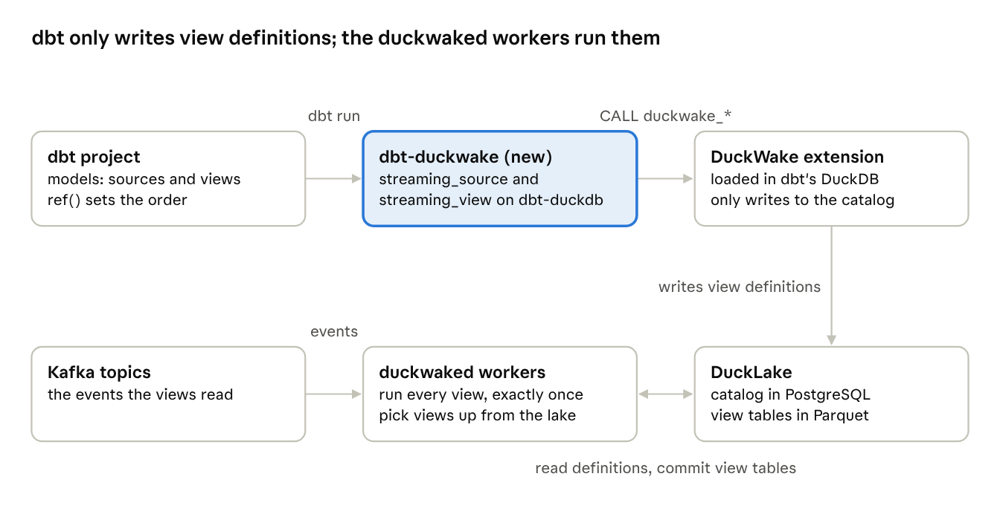

# dbt-duckwake

SQL authoring through dbt · Nov 13, 2026

DuckWake gets SQL-first authoring through a dbt package, dbt-duckwake, built on dbt-duckdb, not through new DDL. A model's `SELECT` becomes a call to `duckwake_create_view`, and dbt brings the files, review, CI, `ref()` ordering, tests and docs. Two engine changes come first: `create_view` learns what changed in a view, and a new view fills from its inputs' existing rows (F3).



dbt never runs a view: it writes definitions through the extension, and the workers pick them up from the lake as they do today.

## Why not DDL

New DDL such as `CREATE STREAMING VIEW` works, but only in our own binaries and at an ongoing cost, so we drop it. A spike on 2026-11-13 proved the path: a C++ parser extension compiled against the DuckDB 2.0.0 that `libduckdb-sys` bundles (it publishes its headers as `DEP_DUCKDB_INCLUDE`) and registered on a database opened through the C API.

- **Worked:** `CREATE OR REPLACE STREAMING VIEW … WITH (…) AS SELECT …` reached our code with the exact statement text; statements before and after it in a batch still ran; ordinary SQL and DuckDB's own syntax errors were untouched.
- **Cost:** it uses DuckDB's internal C++ API, which carries no stability promise (the spike already hit two signatures that differ from older DuckDB), so every DuckDB upgrade means fixing the shim. Our C++ must also be built with the same debug or release setting as DuckDB, or the two disagree on struct layouts.
- **Reach:** only `duckwaked` and `duckwake sql`. The loadable extension uses the stable C API, which has no parser hooks, so `LOAD duckwake` keeps the functions. Quack's `CONNECT` mode was never tested.

OpenIVM gets its `CREATE MATERIALIZED VIEW` the same way, and its README says it needs a source build of DuckDB 2.0.0. dbt gives more than syntax (files, review, CI, lineage, tests) and needs no C++ at all.

`CREATE CONTINUOUS VIEW` stays on the long-term list ([the design doc](streaming-extension.md), SQL surface), built only if users still ask for it once this package exists.

## How dbt-risingwave does it

dbt-risingwave is a thin adapter with the logic in its materializations, and a plain `dbt run` never rebuilds an existing view. We take the shape and the safety rules, and fix one gap: it ignores a changed query.

| Topic | dbt-risingwave | Take for DuckWake |
| --- | --- | --- |
| Adapter | Extends dbt-postgres, since RisingWave speaks Postgres; impl.py is 30 lines | No adapter: DuckWake's tables are DuckLake tables, which dbt-duckdb already reads |
| Streaming view | materialized\_view wraps the model's `SELECT` in `CREATE MATERIALIZED VIEW … AS` | `streaming_view` wraps it in `CALL duckwake_create_view(…)` |
| Sources, sinks | The model file is the whole `CREATE SOURCE` (source.sql); created once, no-op after | `streaming_source` from config, plus `add_source_column` for new columns |
| Plain `dbt run` on an existing view | No-op; only index changes are compared (relation config); a changed query is silently ignored | No-op when unchanged, `alter_view` for settings, and a changed query **fails** asking for `--full-refresh` |
| `--full-refresh` | Drop and recreate, full backfill | `replace := true`: recompute from the start of the topic |
| Zero downtime | Opt-in: build `<name>_dbt_zero_down_tmp_<ts>`, wait, `ALTER MATERIALIZED VIEW … SWAP WITH` | Later: `<name>__next`, `duckwake_wait`, swap tables and views in one DuckLake transaction |
| Long DDL | `background_ddl` plus an object-specific `WAIT` before dbt moves on | `duckwake_wait(view)` before building what reads it |
| Dependents | Never drops with `CASCADE`; fails listing them | Same: the engine already refuses, the package names the readers |

## Design

dbt-duckwake is a dbt package of macros, not an adapter: it adds two materializations to dbt-duckdb, which already connects to DuckDB and reads DuckLake. In the dbt session, dbt-duckdb loads the DuckWake extension and `duckwake_connect` points it at the lake; it only writes definitions to the catalog. The views run on the `duckwaked` workers, which pick them up from the lake as they do today.

| Materialization | Model file | `dbt run` calls |
| --- | --- | --- |
| `streaming_source` | Config only: topic, brokers, format, columns, watermark | `duckwake_create_source`; `duckwake_add_source_column` for columns added later |
| `streaming_view` | A `SELECT` with `source()` and `ref()`, plus view settings in `config()` | `duckwake_create_view(name, '<compiled SQL>', …)`, then `duckwake_start` |

A view model, `models/analytics/clicks_per_min.sql`:

```sql
{{ config(materialized='streaming_view', epoch_interval='2s', max_state_rows=1000000) }}
SELECT window_start, game_id, count(*) AS n
FROM TUMBLE({{ ref('clicks') }}, ts, INTERVAL 1 MINUTE)
GROUP BY ALL
```

`ref('clicks')` names a `streaming_source` model, so dbt orders it first and draws it in the lineage. The compiled SQL must name a source by its bare DuckWake name and a view by its lake table; dbt renders `ref()` as a quoted `"lake"."analytics"."clicks_per_min"`, so either the package controls that rendering or DuckWake's compiler accepts the quoted form (an open question below). A generic test, `duckwake_verified`, runs `duckwake_verify` on a view; ordinary dbt tests run on the views' lake tables.

The extension is unsigned until DuckWake is a signed community extension, so the dbt profile has to allow unsigned extensions. Reaching `duckwaked` over Quack also works, but only through `quack_query` per call: Python clients cannot use `CONNECT`.

## How it's built

The package is Jinja macros and nothing else: no Python, no adapter class. dbt-duckdb does the connecting, and our macros decide which `duckwake_*` calls each model becomes.

**Layout**, in a `dbt/` folder of this repo first:

```
dbt/
  dbt_project.yml                  name: duckwake
  macros/
    materializations/
      streaming_source.sql         create_source, add_source_column
      streaming_view.sql           create_view with if_exists, then reads the result row
    hooks.sql                      duckwake_setup() for on-run-start, duckwake_start_created() for on-run-end
    tests/duckwake_verified.sql    generic test over duckwake_verify
    operations/drop_orphans.sql    lists and drops views no model defines
  example/                         the playground's views as a dbt project, run by CI
```

**Connecting.** The user's profile is an ordinary dbt-duckdb profile that loads the extension; the package's `on-run-start` hook points it at the lake. Nothing else in the session changes, so dbt's tests and docs read the views' lake tables as usual. The profile below is the intended shape and is not tested yet: whether dbt-duckdb can install an extension from our repository URL is the first thing to check.

```yaml
# profiles.yml
analytics:
  target: prod
  outputs:
    prod:
      type: duckdb
      path: ':memory:'
      settings: {allow_unsigned_extensions: true}   # until the extension is signed
      extensions: [{name: duckwake, repo: 'https://ext.example.com/duckwake'}]
      attach: [{path: "ducklake:postgres:{{ env_var('LAKE_CATALOG') }}", alias: lake}]
```

```yaml
# dbt_project.yml of the user's project
on-run-start: "{{ duckwake.duckwake_setup() }}"        # CALL duckwake_connect(...)
on-run-end:   "{{ duckwake.duckwake_start_created(results) }}"
```

**A view model, compiled.** dbt resolves `ref()` and hands the materialization the finished `SELECT` as `sql`. The materialization passes it to `duckwake_create_view`, reads the row that comes back and acts on it:

```

  
  
  
    CALL duckwake_create_view('{{ name }}', '{{ sql | replace("'", "''") }}',
         epoch_interval := '{{ config.get("epoch_interval", "10s") }}',
         if_exists := '{{ mode }}')
  
  
            {# created / unchanged / altered / replaced #}
  
  {{ return({'relations': [this]}) }}

```

A changed query needs no code here: `if_exists := 'update'` makes the engine fail with the view's name and the `--full-refresh` hint, and dbt reports that as the model's error. The checks the engine cannot make alone (readers selected with `-s view+`, a new view over a running one) run in the materialization before the call, from dbt's graph.

**One run, end to end:**

1. `on-run-start`: `duckwake_connect` to the lake.
2. Sources, in dbt's order: `duckwake_create_source`, or `duckwake_add_source_column` for each column the model added.
3. Views, in `ref()` order: `duckwake_create_view(…, if_exists := …)`. A `created` view stays stopped, since `create_view` never starts one; a `replaced` view keeps its status, so a running one recomputes at once.
4. `on-run-end`: `duckwake_start` on every view the run created, all at once (the backfill rule below), then `duckwake_wait` on each when `--vars 'wait: true'` is set.
5. `dbt test`: ordinary tests on the views' lake tables, and `duckwake_verified` on views that declare it.

The engine side is built (Plan step 1): `if_exists` and the outcome as the result's first word. No start flag is needed: `create_view` never starts a view, and a replace keeps the view's status.

## What dbt run does

A plain `dbt run` never recomputes a running view; only `--full-refresh` does, because a recompute replays the whole topic. The package asks the engine what differs between the stored view and the model, then acts on the answer.

| Situation | `dbt run` | `dbt run --full-refresh` |
| --- | --- | --- |
| View does not exist | Create and start it | Same |
| Model unchanged | Nothing | Replace: recompute from the start |
| Only settings changed (`epoch_interval`, `max_rows`, limits) | `duckwake_alter_view`, no recompute | Replace |
| SQL changed | Fail, naming the view and asking for `--full-refresh` (`on_sql_change='warn'` keeps the old view running instead) | Replace |
| SQL changed and other views read it | Fail, listing the readers | Fail unless the readers are selected too (`-s view+`); then replace in dbt's order |
| Source has new columns | `duckwake_add_source_column` for each | Same |
| Source changed otherwise (topic, format, a column's type) | Fail | Recreate the source; its readers need `--full-refresh` too |
| Model deleted from the project | Nothing; dbt does not drop | Nothing; a `duckwake_drop_orphans` operation lists and drops them |

The defaults lean the way dbt-risingwave's do (nothing happens by surprise), except that a changed query is never ignored silently.

## The backfill gap

Built (F3, branch `f3-backfill`): a new view over a lake table or another view now starts from the rows its inputs already hold, so the two rules below are no longer needed and the package can create and start each view as dbt builds it. The rest of this section is the problem as it stood.

Before F3, a new DuckWake view over a lake table or another view saw only the changes made after it was created. RisingWave backfills every new view, and dbt workflows assume that.

The failure is silent. `clicks_per_min` has run for a week; someone adds `top_games`, which reads it, and runs `dbt run -s top_games`. The view is created and runs without error, but holds only the rows from that moment on.

Until F3, the package keeps output exact with two rules:

1. **First deploy:** every view is created stopped, and one `on-run-end` step starts them all. Nothing upstream commits before its readers exist.
2. **A new view over a running one:** refused, with the command to run instead: `dbt run -s +top_games --full-refresh`, which recomputes the upstream views too.

Rule 2 makes adding a view expensive, so F3 comes before the package ships.

## Plan

Two engine changes, then the package; each is its own PR with its own CI suite.

1. **Create what changed (engine). Built 2026-11-14, branch `create-view-if-exists`.** `duckwake_create_view(…, if_exists := 'fail' | 'update' | 'replace')`, and `--if-exists` in the CLI. `update` does nothing when the query and settings match, runs `alter_view` when only settings differ, and fails when what the view computes differs (query, table, late-data table, checkpoint, inlining); whitespace outside quotes and a trailing `;` are not a change. `replace` recomputes. The result's first word says which (`created`, `unchanged`, `altered`, `replaced`). Tested in `schema_test.sh` (CLI, two running workers, every view verified) and `serve_test.sh` (the SQL function over Quack).
2. **Backfill (engine, F3). Built 2026-11-15, branch `f3-backfill`, tested in `scripts/backfill_test.sh`.** A new view over a lake table or a view starts from its input's current rows (a snapshot read) and then follows the change feed, exactly once.
3. **The package (dbt-duckwake v0). Built 2026-11-15, branch `dbt-duckwake`, in `dbt/`, tested in `scripts/dbt_test.sh`.** Departures: a view the run creates is started at once (with backfill there is no first-deploy rule to keep); `--full-refresh` of a view drops its selected readers and creates them again after it, since the engine refuses to replace a view others read; a source that changes other than gaining columns fails even with `--full-refresh`, as there is no SQL function to drop a source yet. `streaming_source` and `streaming_view`, the rerun rules above, `duckwake_wait` before readers are built, the `duckwake_verified` test, and an example project. A CI suite runs the example against the Docker stack: deploy, rerun with no change, change a setting, change a query with `--full-refresh`, add a view over a running one, verify every view.
4. **Next: zero-downtime replace (engine and package).** `--full-refresh` today drops the view's table and recomputes it, so queries see it empty or partly filled until it catches up. Instead the old view keeps running and serving while `<name>__next` is built beside it from the new definition and backfills its inputs; `duckwake_wait` waits for it to catch up, and one DuckLake transaction swaps the two (table, state table, checkpoints, lease) and drops the old copy. Only views no other view reads, at first: a reader holds a position in the old table's change feed, which means nothing in the new table, so a view with readers keeps the rule of step 3 (`-s view+`, readers dropped and created again). Engine: `create_view(…, if_exists := 'rebuild')` and the swap; package: a model config that picks it on `--full-refresh`. Gate: a suite replaces a running view under load while a reader polls its table, never sees it empty or partly built, kills the worker before, during and after the swap, and verifies the new table against its batch recomputation.
5. **Later.** `store_failures` as a streaming view, as dbt-risingwave does.

## Open questions

- [x] `ref()` rendering: DuckWake's compiler accepts quoted three-part names of lake tables and views (`"lake"."analytics"."x"`); the materialization rewrites a `ref()` to a source model into the source's bare name.
- [x] Where the package lives: a `dbt/` folder in this repo (one CI, one release), installed with dbt's `subdirectory:`; `duckwake/dbt-duckwake` once it is listed on dbt Hub, which needs `dbt_project.yml` at a repository's root.
- [x] Connection: the extension in the dbt session. dbt-duckdb installs it from a repository path or URL (`repo:` must carry its own quotes, as dbt-duckdb pastes it into `INSTALL ... FROM`), with `config_options: {allow_unsigned_extensions: true}`; `settings:` is applied too late.
- [x] Kafka passwords stay `env:` or `file:` references, which the engine requires; a model never holds the password.
- [ ] Does a `--full-refresh` of a source cascade to its readers, or only fail and name them? (For now any change but new columns fails; a source can't be dropped through SQL yet.)

## Sources

- dbt-risingwave: README, materialized\_view.sql, source.sql, sink.sql, zero-downtime-rebuilds.md, read 2026-11-13
- OpenIVM: README and `src/openivm_extension.cpp`, read 2026-11-13
- dbt-duckdb
- DuckDB 2.0.0 `parser_extension.hpp` and libduckdb-sys 1.20000.1 `build_bundled_cc.rs`, from the build tree
