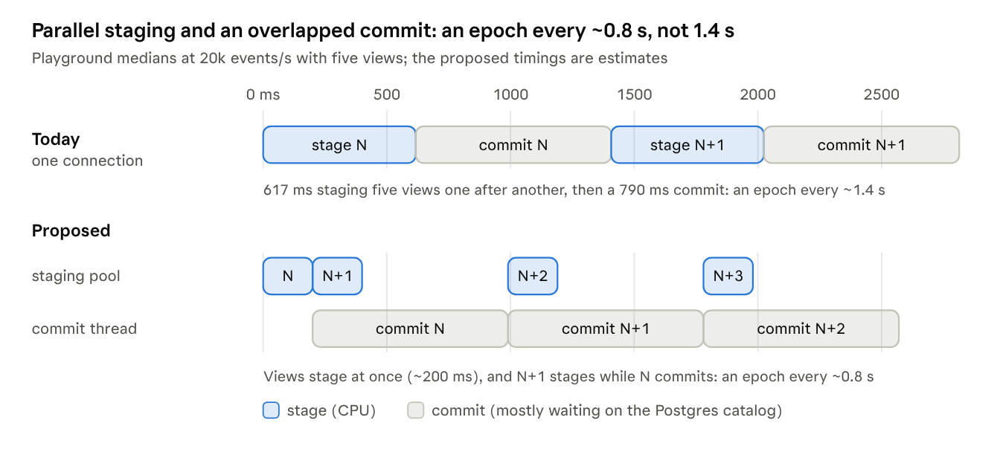

# Parallel processing

Oct 31, 2026

A worker does almost everything one step at a time: it reads each view's source separately, stages the views one after another, and only starts the next epoch after the commit. Doing those three things in parallel should let one worker carry about twice as many views. At the playground's load, an epoch would drop from about 1.4 s of work to about 0.8 s (estimate), and the commit would become the limit. Exactly-once is unchanged: still one transaction per epoch, committed in order.

## Status and measurements (Nov 4)

All four changes are built (v0.1.0). Each sits behind a worker flag that is off by default: `--stage-threads N`, `--pipeline`, `--shared-readers` and `--lean-commit`. Global aggregates overlap through the overlay. Change 4 was chosen from the step 0 split: statements took about 85% of the commit and `COMMIT` about 15%, so the commit now skips writes with nothing to write (in most epochs no window closes) and writes all views' checkpoints and dead letters with one statement each.

**Ceiling.** One worker draining a 300k-event backlog with the playground's view mix (`scale_bench.sh` with `CATCHUP=1`, 10-core laptop):

| Views | Flags off | All four flags | Gain |
| --- | --- | --- | --- |
| 1 | 106k events/s | 108k events/s | 1.0× |
| 4 | 62k events/s | 82k events/s | 1.3× |
| 16 | 21.7k events/s | 40.5k events/s | **1.87×** |

**Steady load.** 16 views on one worker at 20k events/s with 2 s epochs, each change added to the previous ones (medians):

| Per epoch | Flags off | + parallel staging | + pipeline | + shared readers | + lean commit |
| --- | --- | --- | --- | --- | --- |
| Read + stage | 1,552 ms | 512 ms | 529 ms | 245 ms | 297 ms |
| Commit | 662 ms | 571 ms | 594 ms | 494 ms | 327 ms |
| Commit after the newest event was read | 1.6 s | 0.6 s | 0.6 s | 0.3 s | 0.4 s |
| Worker CPU | 89% | 101% | 102% | 48% | 46% |
| Peak memory | 495 MB | 495 MB | 503 MB | 319 MB | 341 MB |

- **The pipeline adds little at a steady rate**: the worker keeps up and waits out the 2 s interval, so there is nothing to overlap. It pays off when the worker is busy, which is what the ceiling runs measure.
- **Shared readers halve the CPU**: before, every view on `clicks` decoded every event again.
- **The commit is now the limit**: about 540 ms of each backlog epoch. The lease check (about 7 ms per view) stays, because fencing needs it.
- **Several workers**: 16 views split over 4 workers use 74% CPU in total with the flags on, against 128% with them off. `COMMIT` itself rises to about 150 ms when 2–4 workers share the catalog.

**Tests.** Crash, fencing, reset, retention, decode and a new shared-reader test pass with the flags off, with `--lean-commit` alone, with the first three flags together, and with all four on. With `--pipeline` the crash test also aborts while an epoch is staged ahead of its commit (`staged_ahead`). A unit test stages global-aggregate epochs before the previous commit lands and checks them against the batch query; it fails when the overlay is removed.

**Left before default-on:** the 24 h soak with at least 8 views and the flags on.

## Where the time goes today

An epoch's work is the sum of every view's staging plus one commit, and only about one core of ten is busy. Measured on the playground worker over 10 minutes on Oct 30: 5 views on one topic at 20k events/s, 3 s epochs, Arrow decode, on a 10-core laptop.

| Step | Median | p95 | Notes |
| --- | --- | --- | --- |
| Stage `big_spends` (filter) | 63 ms | 339 ms | 32k events per epoch |
| Stage `revenue_per_studio` (window + lookup join) | 115 ms | 653 ms | 32k events |
| Stage `clicks_per_10s` (tumbling window) | 117 ms | 602 ms | 32k events |
| Stage `game_activity_hop` (hopping window) | 124 ms | 681 ms | 32k events |
| Stage `game_stats` (global aggregate) | 195 ms | 598 ms | 97k events: catching up on a backlog |
| **Read + stage, all views** | **617 ms** | 3,052 ms | the five stages run one after another |
| **Commit** | **790 ms** | 3,367 ms | one DuckLake transaction for all five views |

The worker was busy 88% of the time and used 116% CPU. Three things keep it serial:

- **One connection stages one view at a time** (`engine.rs::run_epoch`). DuckDB parallelizes a query by row groups of about 122k rows, so a 32k-row epoch mostly runs on one thread.
- **The next epoch waits for the commit.** The commit is mostly waiting on the Postgres catalog, so the CPU is idle for those 790 ms.
- **Each view reads its own copy of the source.** Five views on `clicks` mean five Kafka readers and five Arrow decodes of every event. The decode runs on reader threads, outside the epoch, but it is still five times the CPU and network.

## At a glance

Today one connection stages the views one by one and then waits for the commit. Proposed, a pool stages them together, and the next epoch stages while the previous one commits, so the commit thread is the only thing an epoch waits on.

## Change 1: stage views in parallel

Give each view its own DuckDB connection and stage all views at once; the epoch's staging then takes as long as the slowest view, not the sum. At today's load that is about 200 ms instead of 617 ms.

- **Connections:** `Connection::try_clone()` opens another connection to the same in-memory instance. All connections share the `memory` catalog, so the commit connection reads each view's staging tables exactly as today. Each clone re-runs the per-connection setup (`USE lake`, `SET TimeZone = 'UTC'`).
- **Threads:** a fixed pool of staging threads, each owning one connection, takes views from a queue. The pool size defaults to half the cores, so DuckDB's own threads and the Kafka readers keep room.
- **No shared writes:** staging writes only `memory.main.*_<view>` tables, which no other view touches, and reads the lake only for lookup joins (and global-aggregate state, see Change 2).
- **Lookup joins:** each view's staging starts its own read transaction, so two views joining `dim.games` may read different snapshots of it within one epoch. Lookup semantics already allow that: a dimension is read "as of when the epoch is staged".
- **Failures:** if any view fails to stage, the epoch fails exactly as a staging error does today; nothing has been written to the lake.

An epoch's ordering is unchanged: all views finish staging, then one commit covers them all.

## Change 2: stage epoch N+1 while epoch N commits

The commit is mostly waiting on Postgres and staging is mostly CPU, so they can overlap. A commit thread commits epoch N while the staging pool stages N+1. Under load, epochs then start every max(stage, commit) instead of every stage + commit: about 790 ms instead of 1.4 s today.

- **What N+1 builds on:** epoch N's staged offsets and watermark, which are known before N commits. If N's commit fails, the staged N+1 is thrown away and the worker restarts from the last checkpoint, as on any failure today.
- **Commits stay in order**, on one thread, one epoch at a time. At most one epoch is staged ahead, which bounds memory and the work redone after a failure.
- **Two sets of staging tables:** N+1 must not overwrite the tables N's commit is reading, so staging tables alternate by epoch parity (`out_<view>_0`, `out_<view>_1`).
- **Fencing:** a view whose lease check fails in N's commit is dropped, and its staged N+1 is discarded with it.
- **Maintenance** runs on the commit thread between two commits, while staging continues.

Windows and stateless views can overlap as they are, because their staging never reads the lake's state. A **global aggregate does read it**: staging fetches the old values of the groups it touches (`GlobalPlan::stage_sql`), and those would miss epoch N's changes. Two options:

1. **Keep an overlay (proposed).** After staging N, the worker keeps N's new state for the touched groups in memory. N+1 reads the overlay first and the lake table for every other group. The worker is the state table's only writer, because the lease guarantees that, so the overlay is exact. It is dropped once N commits.
2. **Don't overlap global aggregates.** Stage them only after N commits. This is simpler, but they keep today's latency, and they are the slowest view in the playground.

## Change 3: read and decode each source once

Views on the same source should share one reader and one decode per worker: N views on `clicks` today cost N Kafka reads and N Arrow decodes of every event.

- **One reader per source per worker.** It decodes each chunk once. Views get references to the same Arrow batches, which costs nothing to copy. A chunk's buffer space is released once every view has taken it.
- **Views at a different offset** (a new view, one just reset, or one catching up like `game_stats`) get their own catch-up reader. They join the shared reader once they reach its position.
- **Stage the source once per epoch.** The SQL fallback decode, the dead-letter split and the typed table (`typed_<source>`) are built once, and every view's staging starts from that table. Dead letters are still recorded per view, so `verify` and the dead-letter table keep working unchanged.
- **One drain size per source:** views sharing a reader take the same chunks each epoch, so `max_rows` applies per source (the smallest of its views').

This removes the per-view read, decode and typed-table steps, which are the part of staging that grows with event volume rather than with the query.

## Change 4: measure the commit, then shrink it

After Changes 1–3 the commit is the limit, and we don't yet know where its 790 ms go. Each view adds 5–7 statements to the transaction: the lease check, the state merge, emitting closed windows and deleting them from state, late rows, dead letters, and the checkpoint. Five views make 25–35 statements, then `COMMIT` writes the catalog changes to Postgres.

1. **Measure first.** Log the time spent running statements and the time spent in `COMMIT` separately for each epoch.
2. **If the statements dominate:** write the shared tables once per epoch (one `INSERT` for every view's checkpoint and one for dead letters), and skip writes with nothing to write: no dead letters, no late rows, or no window closing.
3. **If `COMMIT` dominates:** its cost follows the number of tables touched. Each view's lease table stays, because DuckLake conflicts make fencing on a shared table impossible (finding 1 of the first build, in the design doc). What remains is fewer, larger epochs, a longer `EPOCH INTERVAL` for views that can wait.
4. **Last resort: several commits per epoch**, one per group of views, each on its own connection and in parallel. Exactly-once holds per view, so this is safe. The cost is more snapshots and more load on the catalog.

## Expected effect

Estimates, worked out from the medians above for the same five views at 20k events/s, before anything was built. The measurements under Status and measurements replace them: at 16 views one worker's ceiling rose 1.87×.

| Step | Read + stage | Commit | Time between epochs under load | Capacity vs today |
| --- | --- | --- | --- | --- |
| Today | 617 ms, sequential | 790 ms | \~1.4 s | 1× |
| + Change 1: parallel staging | \~200 ms (slowest view) | 790 ms | \~1.0 s | \~1.4× |
| + Change 2: overlap with the commit | \~200 ms, hidden behind the commit | 790 ms | \~0.8 s | \~1.8× |
| + Change 3: one reader per source | less CPU per view | 790 ms | \~0.8 s | \~1.8×, with the CPU freed for more views |
| + Change 4: smaller commit | — | unknown until measured | below 0.8 s | more |

Freshness at light load changes little, because one epoch still takes stage + commit. The gain shows when the worker is busy: epochs keep their pace instead of falling behind, so views stay fresh at higher rates or in larger numbers.

## Why exactly-once is unchanged

Exactly-once rests on three facts, and none of the changes touch them:

1. **One transaction per epoch writes each view's output, state and offsets together.** Parallel staging and the shared reader write only the in-memory catalog; nothing reaches the lake except through the commit.
2. **Commits happen in order.** One commit thread commits epoch N before N+1, and a staged N+1 is never committed unless N was.
3. **Replay is deterministic.** After any failure, the worker throws away everything staged and replays from the committed offsets; decoding and staging give the same rows again. The global-aggregate overlay is only a cache of epoch N's own result, and it is exact because the lease makes the worker the state table's only writer.

The crash points that the crash test already injects (poll, before, during and after `COMMIT`, maintenance) cover the new code paths, once staging runs in the pool and the commit on its own thread.

## Rollout, tests and gates

Each change ships behind a worker flag, off by default, and is turned on by default only after its gate passes.

| Step | What ships | Gate to turn it on |
| --- | --- | --- |
| 0. Baseline | Scaling benchmark: 1, 2, 4, 8 and 16 views on one worker at fixed rates; `catchup_test.sh` for one view's ceiling; 2–4 workers on one lake. Commit time split into statements and `COMMIT`. | Numbers recorded; they replace the estimates above |
| 1. Parallel staging | `--stage-threads N` | Crash, fencing, reset, retention and decode suites pass with N > 1; read + stage is within 20% of the slowest view |
| 2. Overlap | `--pipeline`: windowed and stateless views first, then global aggregates through the overlay | The same suites pass, plus a crash test that kills the worker while an epoch is staged ahead; the time between epochs is within 20% of max(stage, commit) |
| 3. One reader per source | Shared reader, catch-up readers, source-level staging | `decode_test.sh` and `verify` exact; Kafka bytes read per source no longer grow with the number of views |
| 4. Smaller commit | Chosen from step 0's split | Commit time down with no suite failures |
| Default on | All of the above | A 24 h soak with at least 8 views, no worse than today on freshness and memory |

The gate percentages are proposals to agree on before starting.

## Risks and open questions

| Risk | Mitigation |
| --- | --- |
| Concurrent `CREATE OR REPLACE TABLE` on many connections contends on the in-memory catalog | Step 1 measures it first. Fallback: create each view's staging tables once and `TRUNCATE` + `INSERT` each epoch |
| Peak memory rises: several views stage at once, and Change 2 holds two epochs' staging tables | Bounded pool size, at most one epoch staged ahead, and `memory_limit`; memory is part of the soak gate |
| Too many threads: the staging pool, DuckDB's own threads and the Kafka readers compete for cores | Pool defaults to half the cores; DuckDB `threads` set to match |
| One slow view still sets the pace for every view on the worker | Put heavy or backfilling views on their own worker (possible today); see the questions below |

**Open questions**

- [ ] Should a view with nothing new skip an epoch, so slow and fast views on one worker each keep their own `EPOCH INTERVAL`? Each view's checkpoint is independent, so leaving one out of an epoch's commit is safe.
- [ ] Should workers place views automatically by measured cost, instead of `start --worker` by hand?
- [x] Overlay or no overlap for global aggregates in the first version of Change 2? Overlay: built, and covered by a unit test that fails without it.
