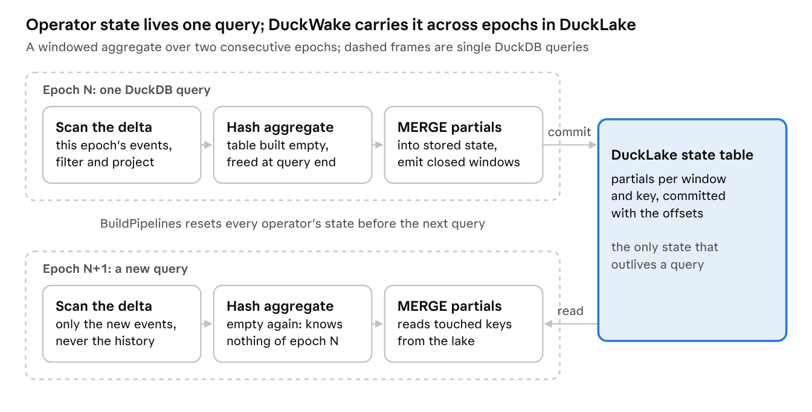
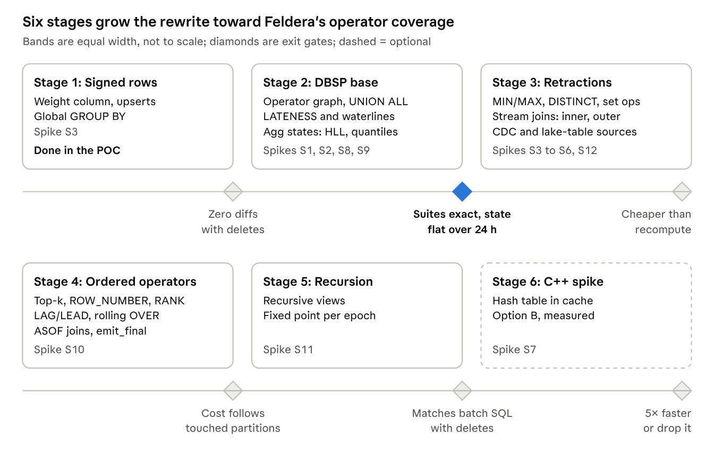

# Stateful operators

Stateful DuckDB operators · Oct 29, 2026

Making DuckDB itself a streaming database is feasible, but not by keeping its operators alive. DuckDB resets every operator's state at the start of each query, by design, and no stable API keeps it. The practical route is to rewrite each view into delta queries (the DBSP model) on stock DuckDB, and keep operator state as DuckLake tables committed with each epoch.

DuckDB 2.0 makes that route stronger than expected. Aggregate states can be exported, merged and stored. We confirmed that `sum`, `avg`, `min` and `approx_count_distinct` states merged across batches give exactly the batch result, and that DuckLake can hold them as plain structs. With a weight column for retractions, this reaches global `GROUP BY`, `DISTINCT` and interval joins at seconds-level latency.

Custom C++ operators or a fork would only pay off for sub-second latency, at the cost of rebuilding against every DuckDB release. They're worth one measured spike, not a commitment.

**Goal (Nov 4).** DuckWake follows DBSP closely and grows toward Feldera's operator coverage. Every view compiles to a circuit of DBSP operators over weighted rows (Z-sets), incrementalized one operator at a time, and the target is the SQL Feldera runs incrementally today: stream–stream and outer joins, `DISTINCT` and set operations, ranking and top-k, `LAG` / `LEAD`, `ASOF` joins and recursion. What stays DuckWake's own is where state lives: in DuckLake, committed with the output and the source offsets in one transaction, so every reader of the lake sees exactly-once results. Feldera as the reference, below, compares the two and lists what to adopt.

## Why DuckDB's operator state dies with the query

DuckDB runs a query as push-based pipelines. A source (a scan) pushes chunks through streaming operators (filter, projection, a join probe) into a sink (a hash aggregate, a join build, a sort). The executor gives each sink one global state shared by all threads, plus one local state per thread that it merges at the end. Both are tied to that one execution.



This is a sound design for analytics: a fresh state per query means no stale data, no locking across queries, and memory released as soon as the result is out. But a streaming engine needs the opposite, a hash table that keeps growing across epochs. That is why DuckWake already keeps state outside DuckDB's operators, as DuckLake tables merged each epoch, and why the question here is how far that approach stretches.

## Operator by operator: what state incremental execution needs

The state an incremental operator must keep is set by its algebra, not by the engine. Each input row carries a weight: +1 for an insert, −1 for a retraction. An operator then falls into one of four classes:

- **Linear:** output delta = operator(input delta), and no state is needed.
- **Mergeable:** keeps a partial result per key and merges each delta into it. It can't undo a merge, so it is correct only on append-only input.
- **Invertible:** keeps a partial result per key and can subtract a retraction from it, as `SUM`, `COUNT` and `AVG` (as sum and count) can.
- **Multiset:** must keep every live value per key, because one retraction can change which value wins. `MIN`, `MAX`, `DISTINCT` and top-k are in this class.

| Operator | Incremental rule | State it must keep | Under retractions | DuckWake today |
| --- | --- | --- | --- | --- |
| Filter, project, scalar functions | Apply to the delta | None | Weight passes through | Supported |
| Lookup join to a lake table | Delta ⋈ table as of the epoch | None; the table is read per epoch | A dimension change doesn't revise past output (temporal join) | Supported |
| Tumbling or hopping window aggregate | Merge partials per open window; emit when the watermark passes | Partials for open windows only | Invertible aggregates fine; `MIN` / `MAX` need a multiset | Supported, append-only |
| Global `GROUP BY` | Merge into per-group partials; emit −old, +new | Partials for every group, forever | Invertible fine; `MIN` / `MAX` /median need value counts per group | Supported (milestone 1): upsert sink, HAVING; MIN/MAX append-only |
| `approx_count_distinct` (HLL) | Merge sketches | One sketch per group | Not invertible: append-only only | Rejected |
| `DISTINCT`, `INTERSECT`, `EXCEPT` | Track a count per distinct row; emit when it crosses 0 | A count per distinct row | Counts go down | Rejected |
| Stream–stream inner join | ΔA ⋈ B + A ⋈ ΔB + ΔA ⋈ ΔB | Both sides' rows, or those within the join interval | Retractions probe the other side | Phase 3 (interval) |
| Outer joins | Inner rule plus per-key match counts | Both sides plus match counts | Null-padded rows appear and disappear | Not planned |
| `ORDER BY ... LIMIT k` (top-k) | Maintain the k best per partition | More than k rows per partition, or all of them | Removing a top row needs the next one | Rejected |
| Window functions (`ROW_NUMBER`, `LAG`, running sums) | Recompute the affected range | The ordered partition | One insert can change many output rows | Rejected |

Two consequences shape the rest of this study:

- **Today's operator matrix stays mostly in the first three rows.** That's why micro-batch SQL rewrite is enough there: only windowed partials need to persist, and DuckLake tables hold them.
- **Everything below needs retractions.** That means signed rows and multiset or match-count state per key. This is where a streaming database differs from a batch engine, whichever engine executes the operators.

## Extension points in DuckDB 2.0

Only one supported mechanism carries operator state from one query to the next: exporting aggregate states as values and storing them in a table. Every hook that runs code inside the executor is C++ only, tied to one exact DuckDB release, and has its state reset per query.

| Hook | API | What it gives a streaming engine | State across queries |
| --- | --- | --- | --- |
| `EXPORT_STATE`, `combine_aggr`, `combine`, `finalize`, `to_aggregate_state` | SQL | An aggregate's partial state as a value. Covers `count`, `sum`, `avg`, `min` / `max`, `approx_count_distinct`, quantiles, `list`, `string_agg` and more. | Yes, as table data. No retraction: `combine_aggr` rejects negative multiplicities. |
| Triggers with `REFERENCING NEW/OLD TABLE` | SQL | A statement's changed rows, inside the same transaction | Rewritten into CTEs at bind time. AFTER … FOR EACH STATEMENT only, and native DuckDB tables only, not DuckLake. |
| Table in-out functions | C++ only | Sees every chunk of a pipeline | No: per query. The stable C API has no in-out functions. |
| `OptimizerExtension`, `OperatorExtension` and a custom `PhysicalOperator` | C++ only, exact version | Rewrite plans and insert your own operators | Only if the operator keeps its state outside the plan, for example in `ObjectCache` or a `ClientContextState` |
| `ParserExtension`, PEG `DialectExtension` | C++ only | New syntax such as `CREATE CONTINUOUS VIEW` | Not applicable |
| Stable C API (v2) | C | Scalar, aggregate and table functions, custom types, options | Aggregates defined through it cannot export state |

What the executor does with state (DuckDB v2.0.0 source):

- **Global sink and operator states live on the operator object.** `PhysicalOperator::BuildPipelines` resets them at the start of every execution, prepared statements included (`physical_operator.cpp:245`).
- **The aggregate hash table is consumed by its own scan.** Its data uses `DESTROY_AFTER_DONE` pinning and the per-partition tables are dropped in finalize (`radix_partitioned_hashtable.cpp:132`, `:1131`).
- **A join hash table can't take more rows once built.** The one reuse case, keeping a build side across iterations, exists only inside a recursive CTE within one query (`physical_hash_join.cpp:827`).
- **No physical state is serializable.** Spilling reuses the exported-state format internally (`aggregate_state_spilling.cpp`), which hints at how a checkpoint could work, but that code isn't exposed.

Tested on our build: `sum`, `avg`, `min` and `approx_count_distinct` states from two batches, merged with `combine_aggr`, finalize to exactly the batch result. DuckLake rejects the `AGGREGATE_STATE` type ("Unsupported user-defined type"). It does store the state's underlying `STRUCT`, which `to_aggregate_state` turns back into a state with exact results. Casting a state to a struct with the wrong field names silently returned 0 instead of an error, so the layout must come from DuckDB, never be written by hand.

## Prior art: everyone who reused a batch engine rewrote its stateful operators

Arroyo (on DataFusion) and Timeplus Proton (on ClickHouse) are the two projects closest to this plan. Both kept the engine's vectorized expressions and stateless operators, and both wrote their own windows, state store, watermarks and checkpoints. The projects built from scratch converged on the same parts, plus a custom versioned LSM state store.

| System | Built on | How changes are represented | State and checkpoints | Lesson for DuckWake |
| --- | --- | --- | --- | --- |
| OpenIVM | DuckDB (SQL-to-SQL compiler) | Delta tables with an insert/delete flag (DBSP model) | Its own delta tables; DuckLake sources via snapshot time travel | IVM can be plan rewriting inside DuckDB. A 2025 thesis found joins pay off only for updates under \~5% of base data. Planned as a community extension by end of 2026. |
| DBSP / Feldera | Own Rust runtime | Z-sets: integer weight per row | LSM-like "spine" of sorted batches; checkpoints every 60 s by default | The cleanest correctness model: incrementalize one operator at a time. The cost is the integrated, indexed state. |
| Arroyo | Apache DataFusion | Debezium-style c/u/d for "updating" queries | Barrier snapshots written as Parquet to object storage; per-key TTL | The closest analogue: reuse the engine, write windows, state tables and updating aggregates as extensions. Acquired by Cloudflare in 2025. |
| Timeplus Proton | ClickHouse codebase | `_tp_delta` = +1/−1 | Epoch checkpoints in native format; RocksDB for mutable state | The best precedent for a C++ vectorized engine. Checkpoint tuning became a production problem (I/O storms at a fixed 5 s interval). |
| RisingWave | From scratch | Insert/delete operations | Hummock LSM on S3; barrier checkpoints about every 10 s | No off-the-shelf state store fit; they built one. |
| Materialize | Differential and Timely Dataflow | (data, time, diff) triples | Shared indexed "arrangements"; Persist on S3 | Shared indexed state is what makes joins affordable. |
| pg\_ivm | PostgreSQL triggers | Hidden count column per view row | Inside the base table's transaction | Trigger-based IVM works in a batch database. `MIN` / `MAX` recompute on delete, and a view lock serializes writers. |
| Flink SQL | Own runtime | Retract and upsert streams | Distributed snapshots | Warns about unbounded `GROUP BY` state and costly ranking updates. |

Two DuckDB-side pieces matter for us:

- **DuckLake's change feed:** `table_changes` returns signed inserts, deletes and update pre/post images between snapshots. It is a ready-made retraction source for views over lake tables.
- **DuckDB 2.0:** adds triggers with transition tables and says they "can also maintain materialized views incrementally". Materialized views themselves are still future work.

## Feldera as the reference

Feldera is the production implementation of DBSP, by the paper's authors. Read on Nov 4 from its docs, its GitHub tree and the `dbsp` crate's API docs, not from its Rust source, so per-operator state details are inferred from names and doc strings.

**How it implements DBSP.**

- **Compiler:** SQL goes through Apache Calcite into a DBSP circuit in a Java intermediate representation (operator classes such as `DBSPJoinOperator`, `DBSPAggregateOperator`, `DBSPIndexedTopKOperator`, `DBSPPartitionedRollingAggregateOperator`). An optimizer pass makes the circuit incremental, and the result is generated as Rust against the `dbsp` crate and compiled into a pipeline.
- **Algebra:** Z-sets and indexed Z-sets carry an integer weight per row. The paper's operators appear almost literally: `Z1` / `delay` for z⁻¹, `integrate`, `differentiate`, `delta0`. Recursion runs in nested circuits that iterate to a fixed point within one step.
- **State:** each stateful operator keeps a "trace": sorted batches of (key, value, time, weight) in an LSM-style spine, merged in the background and spilled to disk, with a read cache and bloom filters. Operator variants such as `integrate_trace_retain_keys` drop state below a waterline.
- **Execution:** N worker threads (default 8), each holding a hash shard of every operator's state, with explicit exchange operators between them. A step runs per input batch. Ad-hoc queries run on DataFusion over materialized state.
- **Time:** a `LATENESS` bound per timestamp column; the compiler propagates it into waterlines that drop state from aggregates, joins, rolling windows and `NOW()` filters (not yet from `LAG` / `LEAD` or materialized views). `emit_final` holds a view's rows until their waterline passes; `append_only` marks insert-only tables.
- **Fault tolerance** (enterprise, partly preview): checkpoints every 60 s, input journaling for exactly-once, and only the Kafka sink is exactly-once on output.

**Aggregates by cost.** Feldera classifies every aggregate by the state its incremental form needs, which matches the four classes above. G = groups, N = stored rows, D = changed rows, M = rows in a touched group.

| Feldera's class | Aggregates | State and work | Class here |
| --- | --- | --- | --- |
| Linear | `COUNT`; `SUM`, `AVG`, `STDDEV`, `VAR` over integers and decimals | O(G), O(D) | Invertible |
| Non-linear | Those same aggregates over FLOAT/DOUBLE (rounding makes retraction inexact); bit operations; `FILTER` clauses | O(N), O(M) | Multiset or recompute |
| Ordered | `MIN`, `MAX`, `ARG_MIN` / `ARG_MAX`, `BOOL_AND` / `BOOL_OR` | O(N), O(D log M); O(G) on append-only input | Multiset (mergeable when append-only) |
| Expensive | `ARRAY_AGG`, `ARRAY(...)`, `MAP(...)` | O(N), O(M) | Multiset |

Feldera lists no approximate aggregates. DuckDB's exported states give DuckWake `approx_count_distinct` and quantiles on append-only input, one place where it can go beyond Feldera.

**Operator parity.** Stages refer to the recommended path below.

| Operator family | Feldera | DuckWake today | Plan |
| --- | --- | --- | --- |
| Filter, project, scalar functions | Yes; SQL and Rust UDFs | Yes; DuckDB's functions, no UDF registration | — |
| `UNION ALL` of streams | Yes | One source per view | Stage 2 |
| `DISTINCT`, `UNION`, `INTERSECT`, `EXCEPT` | Yes, a count per distinct row | `SELECT DISTINCT`; `count(DISTINCT)` in `GROUP BY` views (built 2026-11-16) | Stage 3 |
| Linear aggregates: `COUNT`, `SUM`, `AVG`, `STDDEV`, `VAR`, `COVAR`, `REGR_*` | Yes | `COUNT`, `SUM`, `AVG`, `STDDEV`, `VAR` (built 2026-11-16, branch `aggregates-group1`) | Stage 2: `COVAR`, `REGR_*` |
| Ordered aggregates: `MIN`, `MAX`, `ARG_MIN` / `ARG_MAX`, `BOOL_AND` / `BOOL_OR` | Yes, under retractions | `MIN` / `MAX`, `BOOL_AND` / `BOOL_OR`; under retractions in `GROUP BY` views | Stage 3: `ARG_MIN` / `ARG_MAX`, windows under retractions |
| `ARRAY_AGG`, `MODE`, `list`, `string_agg` | Yes, O(N) | Rejected | Stage 3 |
| `approx_count_distinct`, quantiles | None | Rejected | Stage 2, exported states |
| `GROUPING SETS`, `ROLLUP`, `CUBE` | Yes | Rejected | Stage 3 |
| `TUMBLE`, `HOP` windows | Yes, stateless plus waterline cleanup | Yes, emitted on close | — |
| `SESSION` windows | Not found | No | Later |
| Join to a lake table | A regular join; both sides maintained | Lookup as of the epoch (temporal) | Keep; add a maintained join where a dimension change must revise output |
| Stream–stream inner join | Yes | No | Stage 3 |
| Outer, semi and anti joins | Yes | No | Stage 3 |
| `ASOF` join | Yes (`LEFT`, `>=` only) | No | Stage 4 |
| Top-k, `ROW_NUMBER`, `RANK`, `DENSE_RANK` | Yes | Rejected | Stage 4 |
| `LAG` / `LEAD`, rolling `OVER` aggregates | Yes, constant frames | Rejected | Stage 4 |
| Recursive views | Yes, fixed point per step | No | Stage 5 |
| Per-column `LATENESS`, waterline state cleanup | Yes, propagated through operators | `watermark_delay` per source; only window state is cleaned up | Stage 2 |
| `emit_final` | Any view with a waterline column (experimental) | Windowed views only | Stage 4 |
| Sources with updates and deletes (primary keys, CDC) | Yes | Kafka, append-only | Stage 3 |
| Unbounded-state warnings, `expected_size` hints | Yes | No | Stage 2 |

**What DuckWake keeps different, on purpose.**

- **State lives in DuckLake, not a local LSM.** A view's state tables commit with its output and offsets in one transaction. Exactly-once then holds for every reader of the lake with no journal, where Feldera's holds only for its Kafka sink. Recovery reads the lake, so a worker keeps no local state and can move freely.
- **Epochs, not per-batch steps.** Feldera steps per input batch. DuckWake's epochs trade latency for one lake commit per interval, which is what keeps DuckLake's snapshot count and file count in check.
- **Lookup joins are temporal by default.** Reading a dimension as of the epoch is cheaper than maintaining it as a join side, and it is what most users of a dimension table want. A maintained join becomes an opt-in.

**Ideas to adopt.**

1. **Compile to a DBSP operator graph.** Today each view kind (windowed, global, stateless) has its own template. Instead, compile to an explicit graph of DBSP operators (map, filter, index, join, aggregate, distinct, integrate, differentiate), each with its delta rule and, when stateful, a DuckLake state table, then generate one SQL step per operator. Every operator added after that works in every view. This is the base for everything in the parity table.
2. **Classify aggregates by linearity at compile time,** as in the table above, and treat linear aggregates over FLOAT/DOUBLE as non-linear. DuckWake's global aggregates subtract retracted doubles today, which is exact only while sources are append-only.
3. **`LATENESS` per timestamp column, propagated as waterlines.** Use them to delete state below the waterline in aggregates and joins, generalizing what windowed views do when a window closes.
4. **Warn at create time when state is unbounded,** and accept an `expected_size` hint for small dimension tables, so a view that will grow forever is visible before it runs.
5. **An `append_only` property.** Kafka sources are append-only by default, which keeps `MIN` / `MAX` cheap; sources with updates (CDC, primary keys) switch the plan to multiset state.
6. **`emit_final` for any view with a waterline column,** generalizing emit-on-window-close.
7. **Shared indexed state for joins.** Feldera's traces and Materialize's arrangements both index a collection once and let many operators read it. A join side kept as one DuckLake table per source and key, shared by every view that joins on it, is the DuckWake version.

## How engines store state

Streaming engines keep operator state in one of two ways, and the field is moving from the first to the second, where DuckWake already is.

| Family | Engine | Working state | Durable copy, recovery |
| --- | --- | --- | --- |
| Local state, checkpointed out | Flink (1.x) | heap or embedded RocksDB, sharded by key | barrier checkpoints to S3/HDFS (incremental for RocksDB); recovery downloads them and replays sources from the checkpointed offsets |
|  | Kafka Streams | RocksDB store per partition on local disk | every write also goes to a compacted changelog topic; recovery replays it, standby replicas stay warm |
|  | Spark Structured Streaming, Databricks | state store per partition, in memory or RocksDB | versioned snapshots and changelog files in the checkpoint directory on cloud storage |
|  | Feldera | traces: LSM-style spines of sorted batches, in memory, spilling to local disk | checkpoints to object storage plus input journaling (enterprise) |
|  | Arroyo | in-memory tables per operator | checkpoints to object storage per epoch (format not verified) |
| Shared storage is the state | RisingWave | Hummock, an LSM tree on S3, compacted by compactor nodes | committed every barrier (about 1 s); nothing to restore, compute nodes cache blocks in memory and on disk |
|  | Materialize | Persist: blobs in S3, metadata in CockroachDB or Postgres | compute keeps in-memory arrangements rebuilt from Persist; Kafka upsert state is RocksDB, rebuilt from Persist |
|  | Flink 2.0 | ForSt, a disaggregated backend with state files on S3 or DFS | checkpoints and rescaling stop copying all state; a local cache serves reads |
|  | DuckWake | DuckLake tables: Parquet files and a Postgres catalog | committed in the same transaction as the output and the Kafka offsets; nothing to restore |

The first family is fast on the hot path but pays at recovery and rescaling, and its state cannot be queried from outside. The second makes recovery and rescaling cheap and pays latency on every state access, which is why RisingWave, Materialize and Flink 2.0 all add a local cache.

DuckWake has two things none of them has together: its state is an ordinary table, queryable with SQL and rewound by DuckLake time travel (`reset`), and it commits atomically with the output and the offsets, so there is no separate checkpoint. What it lacks is the cache: every epoch reads the touched keys' state from the lake. That is the cached-state step under "Making it fast"; S5's join benchmark decides when it is needed. The in-memory tables DuckWake uses (the `memory` catalog of its embedded DuckDB) are per-epoch staging, not state: they hold one epoch's decoded rows and intermediate results, and are rebuilt from Kafka after a crash.

From general knowledge of each engine, except the CDC-specific points, which the research in [CDC sources](cdc-sources.md) confirms from source.

## Options compared

Rewriting on stock DuckDB reaches every operator in the table above at seconds-level latency, with no version lock. The other three options trade that for lower latency.

| Option | What we build | Latency floor | Retractions | State and checkpoint | Upgrade risk | Verdict |
| --- | --- | --- | --- | --- | --- | --- |
| **A. DBSP-style rewrite on stock DuckDB** (today's design, extended) | A weight column through the compiler; state as DuckLake tables (exported aggregate states, multisets, join sides) | One epoch: seconds | Yes, through the weight column and invertible or multiset state | Free: one DuckLake commit per epoch, as today | Low: SQL and the stable surface only | **Chosen (Nov 4)**, on the operator graph |
| **B. Stateful operators in a C++ extension** | Custom `PhysicalOperator`s keeping hash tables in `ObjectCache` across queries; an `OptimizerExtension` to plan them | Sub-second possible | We implement them per operator | We build serialization and checkpoints; none exist | High: rebuild and retest on every DuckDB release; relies on internal classes | Spike only, to measure the latency gain |
| **C. Fork DuckDB** | Persistent, appendable sink states and state serialization in the executor | Sub-second | Our own design | Our own design | Very high: we carry a fork of a fast-moving engine | No |
| **D. Separate dataflow runtime** (DBSP/Feldera-like), with DuckDB for batch reads | A full streaming engine, using DuckDB only for scans and expressions | Milliseconds | Native | Our own state store, as RisingWave and Feldera did | Medium | No: it's building a different product |
| E. The dbsp crate as the operator runtime, forked so each operator's state persists as DuckLake rows | A generic row type and glue from our operator graph to dbsp; expressions evaluated by DuckDB per batch; state written to DuckLake as (key, value, weight) rows each epoch | Sub-second | Native | In dbsp's memory, persisted to DuckLake | High: a fork of a fast-moving crate (0.375) whose dynamically typed internals are unsafe and built for generated code | No: reference and test oracle only (Nov 4) |

Option A's cost is reading and rewriting the touched state every epoch. That stays cheap while a delta is small relative to the state: OpenIVM's \~5% figure for joins is the rough boundary. Windows bound state by time and late data, so they stay well inside it. Unbounded global aggregates over huge key spaces, and joins of two fast streams, are where Option A runs out, and where the Stage 4 spike of Option B would tell us what sub-second would cost.

## Decision (Nov 4): our own DBSP operators, compiled to SQL

DuckWake implements the DBSP operators itself, on an explicit operator graph (spike S8), and executes them as SQL in DuckDB with state in DuckLake. This is Option A made systematic. Feldera's `dbsp` crate is the reference implementation and the test oracle: its operator set, semantics and tests guide ours, but it is not a dependency.

**Why not the dbsp crate (Option E).**

- **It is built for compiled queries.** Feldera generates typed Rust per pipeline and compiles it. DuckWake creates views at runtime, so it would need a generic row type plus glue over dbsp's internal, unsafe dynamic layer.
- **It bypasses DuckDB.** dbsp's map and filter run a closure per record; using DuckDB's vectorized engine would mean converting batches around every stateless step.
- **A fork drifts.** The crate is at 0.375 with frequent releases.
- **State would live in two places,** dbsp's memory and its DuckLake copy. Option A keeps it in one, which keeps workers stateless and `reset` working by time travel.
- **Its own checkpoints are out of the question:** state must commit with output and offsets in the DuckLake transaction. Its storage backend sees opaque 512-byte blocks of serialized files, not rows, and no API loads state from outside.

**Execution model: SQL in DuckDB, Arrow at the edges.** A Z-set is a table with a weight column `__w` (+1 insert, −1 delete). Each operator's incremental rule is one set-oriented statement over the epoch's changes (Δ) and the operator's state, which DuckDB runs vectorized:

| Operator | Rule | State |
| --- | --- | --- |
| map, filter, project, `UNION ALL`, negate | `SELECT f(x), __w FROM Δ WHERE p(x)`; negate is `-__w` | None |
| Consolidate | `GROUP BY ALL HAVING sum(__w) <> 0` | None |
| Join | `ΔA ⋈ B + A ⋈ ΔB + ΔA ⋈ ΔB`, weights multiplied | Both inputs |
| Linear aggregate | weighted partials per group, merged into state; emit −old and +new for changed groups | One partial per group |
| `DISTINCT` and set operations | the change's counts joined to stored counts; emit where a count crosses 0 | A count per row |
| `MIN` / `MAX` under deletes | value counts updated, then min or max over the touched groups | A count per group and value |
| Top-k, `ROW_NUMBER`, `RANK`, `LAG`, rolling `OVER` | window functions over the touched partitions or ranges; emit old versus new | The ordered partitions |
| Recursion | a loop in Rust, each iteration one statement over the new rows | The fixed point's relation |

**Evidence (DuckDB 2.0 CLI, Nov 4).**

- **The rules are exact.** The join rule (467 changed rows) and the `DISTINCT` rule (2 changed rows) on random data with inserts and deletes gave 0 differences against recomputing before and after. The join rule ran as three vectorized hash joins.
- **Scanning state in memory is cheap.** A 1,000-key change joined against a 10M-row state table in DuckDB's memory took 8–15 ms; sorting the state or indexing the key barely changed it. DuckDB hashes the small side and streams the state at about 1 ms per 1M rows. The cost DuckWake pays today is reading state from DuckLake, which is what cached state removes.

**Why not Arrow kernels in Rust.** A view is DuckDB SQL, and `verify` checks it against DuckDB running the same SQL as a batch. Evaluating expressions ourselves would mean reimplementing DuckDB's functions, casts, `DECIMAL` arithmetic, timestamps and NULL rules exactly. Arrow's Rust kernels also lack hash joins, grouped aggregation and window functions, so it would take a second engine. Arrow stays at the edges: decoding, appending batches into DuckDB, and handing output on.

**Making it fast.**

1. **Fuse.** Each chain of stateless operators plus the next stateful one compiles to one statement; only state tables are materialized.
2. **Prepare once.** An epoch's SQL is identical for each table set, so each view's statements are prepared once and reused.
3. **Cache state** in the worker's in-memory DuckDB between epochs, and write only the changes to DuckLake. DuckLake stays the durable copy, and a restarted worker reloads from it.
4. **Generate from the graph,** never by concatenating strings, so each operator rule is unit-tested against an oracle, as above.

**Escape hatch.** A single operator moves to a native implementation (Option B, Stage 6) only when measurements show a need: state far beyond 100M rows per operator, or epochs under about 100 ms. Even then, DuckDB evaluates every expression.

**What spike S8 delivers.**

- **Graph types:** operators in topological order, ports, and a delta or collection kind per output, as in Feldera's `DBSPCircuit`.
- **Translation** from DuckDB's parsed SQL into the graph.
- **Incrementalization:** wrap the graph as D ∘ Q ∘ I, cancel D and I through the linear operators, and give each remaining stateful operator its rule and a DuckLake state table.
- **SQL generation with fusion.**
- **Today's three view kinds** (windowed, global aggregate, stateless) recompiled through it.

The gate is spike S8's: every suite verifies exactly, and epoch time stays within 10% of today's templates.

## Feldera's rules and ours

S8 passed on Nov 4, and DuckWake's incrementalization now uses the same rules as Feldera's compiler: wrap the query as D ∘ Q ∘ I, then push every integrator forward until it meets a differentiator. Read from Feldera's source at commit `e935b90` (Nov 3, 2026); the passes run in this order inside `CircuitOptimizer`.

| Feldera pass | What it does | DuckWake (`circuit.rs`) |
| --- | --- | --- |
| `IncrementalizeVisitor` | Each source emits changes followed by I; each sink reads through a D. Constants and `NOW()` become D then I. | Same wrap for sources and sinks. No constants or `NOW()` yet. |
| `OptimizeIncrementalVisitor`, linear operators | L ∘ I = I ∘ L for map, filter, flat map, map-index, hop, negate. Chain aggregates and rolling aggregates are treated the same way. | Same rule for Weigh, Window, LateSplit and Map. |
| Same pass, stateful operators | S ∘ I = I ∘ SΔ when every input is integrated: stream aggregate → aggregate, stream distinct → distinct, stream join → join, sum and subtract over several inputs. | Aggregate → AggregateΔ only. Distinct, join and union are the next rules. |
| Same pass, plus `RemoveIAfterD` | D ∘ I = id, and I ∘ D = id where it is left over. | D ∘ I = id. I ∘ D never arises yet. |
| `NoIntegralVisitor` | Fails compilation if an integrator is left. | Code generation refuses any I or D left, and `explain` names it. |
| `ExpandAggregates` | Picks an aggregate's implementation by kind and by whether its input is append-only: linear (`count`, `sum`, `avg`) as D, a linear aggregate and I; `MIN` / `MAX` over append-only input as a chain aggregate; `MIN` / `MAX` over retractions as a per-group value trace; other non-linear aggregates over the integrated input. | Partial sums and counts in the state table match the linear case. `greatest` / `least` in state match the chain aggregate and are correct only because Kafka sources are append-only. |
| Delta expansions | Join = ΔL ⋈ z⁻¹R + z⁻¹L ⋈ ΔR + ΔL ⋈ ΔR; distinct = a binary distinct of the input's integral and its change; aggregate = integrator, primitive aggregate, upsert feedback. | z⁻¹ is the DuckLake state table as of the last commit, or the overlay with the previous epoch's new state when commits are pipelined. The join rule measured earlier is this expansion. |
| `MonotoneAnalyzer` / `InsertLimiters` | Turns `LATENESS` into waterlines: controlled filters drop late rows, `IntegrateTraceRetainKeys` prunes state, and `emit_final` inserts a window before the view. | One watermark per source. LateSplit routes late rows to a table; the DELETE of closed windows is the retain-keys pruning; emit on close is `emit_final`. S9 generalizes this to every column with a lateness. |
| `OptimizeDistinctVisitor` | distinct ∘ distinct = distinct; distinct(map(distinct x)) = distinct(map x); a filter moves before a distinct; join of distincts = distinct of the join. | None yet; these come with `DISTINCT`. |

Two things to add before `DISTINCT` and stream–stream joins:

1. **An append-only analysis.** Feldera marks every stream that never retracts and picks cheaper operators for it. Once `DISTINCT`, joins or lake-table sources can retract rows, `MIN` / `MAX` behind them needs the per-group value counts of spike S4, not `greatest` / `least`.
2. **Multi-input rules.** Join, union and difference take S ∘ I = I ∘ SΔ only when all their inputs are integrated; the graph and the rewrite already allow several inputs, and code generation has to follow.

Feldera's optimizer runs dozens of other passes. Most are ordinary optimizations (constant propagation, CSE, projection pushdown, join balancing) that DuckDB's own optimizer does for each generated statement.

## Operator graph design

The graph keeps a small set of base operators, sorted by algebraic class, so the rewrite rules work on the class and never on the operator. Every SQL feature lowers into these operators, the way Feldera's `ExpandAggregates` does.

| Class | Base operators | Incrementalization | State |
| --- | --- | --- | --- |
| Source, sink | `Source`, `Sink(append \| upsert)` | I after a source, D before a sink | none |
| Linear, one input | `Map`, `Filter`, `FlatMap` | L ∘ I = I ∘ L | none |
| Linear, several inputs | `Union`, `Negate` | the same, when every input is integrated | none |
| Bilinear | `Join` (equi-join) | ΔL ⋈ z⁻¹R + z⁻¹L ⋈ ΔR + ΔL ⋈ ΔR | both sides |
| Non-linear | `Aggregate`, `Distinct`, `TopK` | S ∘ I = I ∘ SΔ | per key |
| Time | `Waterline`, `EmitFinal` | linear on the rows, plus a watermark | small |
| Rewrite only | `Integrate`, `Differentiate`, `Delta(op)` | must all be gone after the rewrite | — |

Lowering examples: `TUMBLE` is a `Map` and `HOP` a `FlatMap`; `HAVING` is a `Filter` after the `Aggregate`; `avg` is a linear sum and count followed by a `Map`; `LEFT JOIN` is a `Join` plus the padded anti-join; `EXCEPT ALL` is a `Union` with a `Negate`.

**Weights on every edge.** Every relation in the graph is a Z-set with a `__w` column. `Map` and `Filter` keep it, `Join` multiplies the two sides' weights, and `Aggregate` sums `x * __w` and `__w`. A Kafka source sets `__w = 1` and a CDC source ±1, so retractions need no change to any other operator.

**Node properties.** Each node carries its schema and properties that analysis passes fill in before the rewrite: `append_only` (no −1 can reach it), `key` (columns unique in it) and `lateness` (an event-time column and its bound). Code generation reads them to pick an implementation: `MIN` over an append-only input keeps one value per group, and over retractions it keeps a count per value.

**Two code generation contracts.**

- A linear operator returns a `SELECT` over its inputs. Consecutive linear operators fuse into one statement, and DuckDB optimizes inside it.
- A stateful operator `Delta(op)` declares its DuckLake state table (`state_<view>_<node>`, schema and key). In staging it groups its input change by key, reads the old state of the touched keys only (z⁻¹), and computes the new state and its output change. In the commit it deletes and inserts the state of those keys. Pipelined overlays, lean-commit skips and crash points apply to every stateful operator through this contract.
- A table is materialized only at a stateful operator, an edge read by more than one operator, and a sink.

**Compile pipeline.** SQL → DuckDB parse tree (`json_serialize_sql`) → Q over base operators → analyses (schema, `append_only`, `key`, `lateness`) → incrementalize → rules such as the `DISTINCT` simplifications → stage and commit steps → the engine. `duckwake explain` prints every stage. Each operator gets a property test: on a random Z-set stream, opΔ must equal D ∘ op ∘ I, with the right side run as batch SQL in DuckDB.

**Build order.**

1. `__w` on every edge, node properties and the append-only analysis. Small, and opens the way for CDC sources.
2. Replace today's opaque `Map(Fragment)` SQL fragments with structured `Map`, `Filter` and `Join`, lowered straight from DuckDB's parse tree. The largest step, mostly in `plan.rs`; until then a join inside a fragment cannot be incrementalized.
3. `Delta(Distinct)` and `Delta(Join)` on the shared state contract (spikes S4 and S5).
4. General `Waterline` and `EmitFinal` for any column with a lateness (spike S9), replacing today's `LateSplit` and closed-window delete.

## Codebase structure

The DBSP layer gets its own crate, `duckwake_circuit`, with one file per operator. Adding an operator then touches four known places and nothing in the engine; today it means editing seven `match` statements in `circuit.rs`.

```
crates/
  circuit/                duckwake_circuit: no Kafka, no engine, no lake
    src/
      ir/                 Circuit, Node, Port, NodeId, Schema, Expr, Props, explain output
      ops/                one file per operator: source, sink, map, filter, flat_map, union,
                          negate, join, aggregate/{linear, chain, multiset}, distinct, topk,
                          waterline, emit_final, integrate, differentiate
      frontend/           DuckDB parse tree -> Q, one lowering per SQL feature, rejections
      passes/             analyze, incrementalize, distinct rules, dead code, validate
      codegen/            Step, fusion, the shared state contract, table names
    tests/                property-test harness, one test per operator, golden explain output
  core/                   engine, catalog, Kafka, maintenance: consumes a compiled view only
```

**Operator contract.** `Op` is an enum of per-operator structs that all implement one `Operator` trait: name, class (source, sink, linear, bilinear, non-linear, rewrite-only), arity, output schema, output properties, an optional check (a chain `MIN` needs append-only input), a `SELECT` for linear operators, and a `Stateful` form for the others. An enum keeps exhaustiveness checks, serde, and pattern matching for operator-specific rules such as distinct ∘ distinct = distinct; one macro forwards the trait to the variant.

**Shared state contract.** A stateful operator supplies only its key, its state columns, and two pieces of SQL: how a change folds into the state, and how its output change follows. `codegen/state.rs` does the rest for every operator: reading the old state of the touched keys (z⁻¹), the pipelined overlay, the delete and insert of those keys at commit, lean-commit skips and crash points.

**Adding an operator.**

1. `ops/<name>.rs`: the struct, its `Operator` impl, and `Stateful` if it is not linear.
2. One variant in `enum Op`.
3. Its lowering in `frontend/`, or its removal from the rejection list.
4. `tests/op_<name>.rs`: one call to the harness, which checks the operator's SQL against D ∘ op ∘ I on random streams with retractions.

The incrementalization rules look only at the class and the engine runs only steps, so neither changes.

**Stable node ids.** State tables are named per node, so a node's id must survive recompiles and upgrades. As in Feldera's `MerkleHashes` pass, the id is a hash of the operator and its input subtree, stored with the view: the same subtree finds the same table, and a changed one gets a new table and a backfill. This is also what `OR REPLACE` for views builds on.

**Expressions.** `Expr` starts as SQL text plus the columns it reads, which is enough for projection pruning, keys and filter pushdown. It grows into a tree only when a pass needs to look inside.

**Migration.** (1) Create the crate and move `circuit.rs` into `ir/`, `passes/` and `codegen/` with no change in behaviour. (2) Turn today's operators into `ops/` files; the opaque `Map(Fragment)` becomes a transitional `SqlFragment` operator. (3) Build the harness and cover the existing operators. (4) Lower SQL to real `Map`, `Filter` and `Join`, and remove `SqlFragment`.

## Recommended path



Each stage widens the operator matrix on stock DuckDB toward Feldera's coverage (the parity table above) and ends at a gate from the spikes below.

- **Stage 1 (done in v0.1.0):** signed rows end to end. A weight column through the compiler, upsert sinks, and global `GROUP BY` with invertible aggregates.
- **Stage 2, the DBSP base:** compile views to an explicit DBSP operator graph. On top of it: `UNION ALL`, the remaining linear aggregates (`STDDEV`, `VAR`, `COVAR`, `REGR_*`), per-column `LATENESS` with waterline state cleanup, unbounded-state warnings, and exported aggregate states for `approx_count_distinct`, quantiles and `list`.
- **Stage 3, retractions everywhere:** multiset state for `MIN` / `MAX`, `ARG_MIN` / `ARG_MAX` and `ARRAY_AGG`; `DISTINCT` and set operations; stream–stream inner, outer, semi and anti joins; `GROUPING SETS`; sources with updates and deletes (CDC, primary keys, DuckLake tables through `table_changes`).
- **Stage 4, ordered operators:** top-k, `ROW_NUMBER` / `RANK` / `DENSE_RANK`, `LAG` / `LEAD`, rolling `OVER` aggregates, `ASOF` joins, and `emit_final` for any view with a waterline.
- **Stage 5, recursion:** recursive views computed to a fixed point within each epoch.
- **Stage 6, optional:** runs only if a user needs sub-second latency. It measures Option B before anyone commits to maintaining C++ operators.

## Spikes to run first

Each spike answers one question the roadmap depends on, and has a bar that decides it. The bars are proposals to agree on before running.

| Spike | Question | Pass bar |
| --- | --- | --- |
| S1. State layout from DuckDB | Can the compiler read each aggregate's state `STRUCT` layout from DuckDB, store it, and restore it with `to_aggregate_state`, with no hand-written casts? | Works for every aggregate in the matrix; a layout mismatch fails loudly instead of returning 0 |
| S2. Exported states at scale | What does merging a 50k-event delta into 1M groups of `avg` + `approx_count_distinct` + `quantile` states in DuckLake cost? | Merge and commit under 30% of a 10 s epoch; cost grows with touched groups, not total groups |
| S3. Signed global `GROUP BY` | Do upsert sinks and invertible aggregates over a weight column, fed by inserts, deletes and updates, match batch recomputation? | Zero differences on the differential test, including deletes that empty a group |
| S4. Multiset `MIN` / `MAX` and `DISTINCT` | What does keeping value counts per group cost, against recomputing affected groups? | Cheaper than recompute while deltas stay under 5% of state |
| S5. Interval stream–stream join | Can both sides live as DuckLake state tables, pruned by watermark, at 5k events/s per side with a 10-minute interval? | Staging and commit inside the epoch; state bounded by the interval |
| S6. Lake tables as sources | Can `table_changes` between snapshots feed a continuous view over a DuckLake table, retractions included? | Results match batch SQL across inserts, deletes and updates |
| S7. C++ stateful operator | How much latency does keeping a `GroupedAggregateHashTable` in `ObjectCache` across epochs save, against Option A on the same workload? | At least 5× lower per-epoch latency, or Option B is dropped |
| S8. DBSP operator graph | Can today's three view kinds be recompiled as a graph of DBSP operators, one SQL step per operator, with no loss in epoch time? | Every suite verifies exactly; epoch time within 10% of today's templates. Passed Nov 4: 24 of 24 suite runs, epoch p50 2.35 s against 2.35 s |
| S9. Waterline state cleanup | Does per-column LATENESS, propagated through joins and aggregates, keep state bounded on a 24 h stream? | State rows flat over the run; output equal to batch SQL over the non-late input |
| S10. Top-k and ranking | What do ROW\_NUMBER and top-k cost per epoch when state is a DuckLake table ordered per partition? | Cost follows the touched partitions, not total rows |
| S11. Recursion per epoch | Can a recursive view (transitive closure) reach its fixed point inside one epoch with DuckDB's recursive CTEs over the epoch's delta? | Matches batch SQL across inserts and deletes |
| S12. Shared join state | Can several views share one indexed DuckLake table per join side without commit conflicts between them? | No conflicts at 8 views per worker; state written once per epoch |

## Sources

DuckDB internals come from the v2.0.0 source vendored by the `duckdb` crate (`target/duckdb-sources/.../duckdb`), and the state round trip was run on DuckWake's build. Web pages were opened on 2026-10-29.

- DuckDB: [DuckDB 2.0 announcement](https://duckdb.org/2026/10/21/announcing-duckdb-200), DuckDB 2.0 highlights, DuckDB streaming patterns
- DuckLake: data change feed, [DuckLake 1.1](https://ducklake.select/2026/10/21/ducklake-11/), data inlining
- OpenIVM: paper, wiki, 2025 MSc thesis on joins
- DBSP / Feldera: DBSP paper, incremental aggregates, storage, fault tolerance
- Arroyo: 0.10 release, architecture, updating tables, Cloudflare acquisition
- Timeplus Proton: journey to open source, changelog streams, checkpoints, checkpoint lessons
- RisingWave: Hummock, architecture
- Materialize: arrangements, architecture
- Others: pg\_ivm, Flink dynamic tables, Tributary, Denormalized
