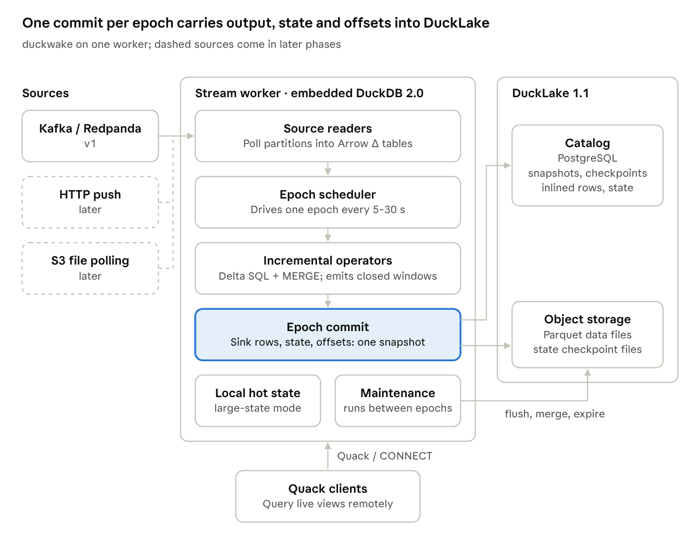
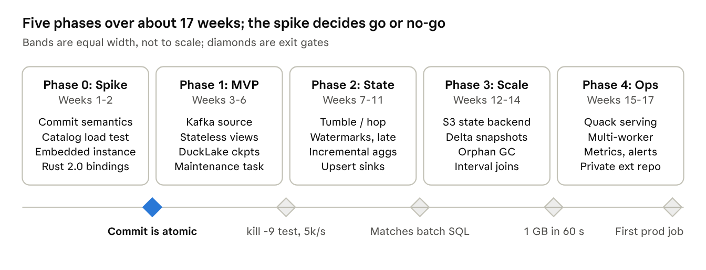

# DuckWake design: a streaming extension for DuckDB

Oct 27, 2026

## Summary and goals

We will build a DuckDB 2.0 extension, DuckWake (duckwake) that runs continuous SQL over event streams in micro-batches and commits results, operator state and source offsets to DuckLake in one transaction. That single commit gives exactly-once output without a separate coordinator or two-phase commit.

The target is small to medium workloads: up to about 10k events/s per job on one node, with 5–30 s end-to-end latency. It is not a replacement for Flink or RisingWave at large scale. It is a simple, SQL-first option for teams already on DuckDB and DuckLake.

Success criteria for v1:

- A Kafka topic feeds a windowed aggregate into a DuckLake table with no duplicates or gaps after a kill -9 at any point.
- Sustained 5k events/s (about 1 KB each) on 4 vCPU / 16 GB, p95 end-to-end latency under 30 s.
- Recovery to the last committed epoch in under 60 s with state up to 1 GB.
- File count in the lake stays bounded: no table accumulates more than a few hundred live data files per day after maintenance.

Why now: DuckDB 2.0 (released 2026-10-21) adds triggers with transition tables, an extensible PEG parser, the Quack server protocol and async I/O, and DuckLake 1.1 ships alongside it ([DuckDB 2.0 announcement](https://duckdb.org/2026/10/21/announcing-duckdb-200), [DuckLake 1.1](https://ducklake.select/2026/10/21/ducklake-11/)).

Deep dives: [Stateful operators](stateful-operators.md) (how far the SQL-rewrite approach stretches) and [Arrow ingest plan](arrow-ingest.md) (decoding Kafka JSON in Rust).

Proposal: [Parallel processing](parallel-processing.md) (about twice the views per worker, with exactly-once unchanged).

Direction (Nov 4): follow DBSP closely and grow toward Feldera's operator coverage, while keeping state in DuckLake so output stays exactly-once for every reader of the lake. The parity table, the ideas to adopt and the six-stage path are in [Stateful operators](stateful-operators.md).

## Requirements and scope

**Functional**

- Define sources (Kafka-compatible first; HTTP push and file/S3 polling later) with event-time column and watermark delay.
- Define continuous views in SQL: filter, project, lookup joins to DuckLake tables, tumbling and hopping window aggregates.
- Write results to DuckLake tables (append, or upsert by key for aggregates).
- Checkpoint to one of two backends: DuckLake tables, or object storage files with a DuckLake or manifest pointer.
- Start, stop, pause and inspect jobs from SQL; resume from the last checkpoint after restart.
- Serve live results to remote clients through Quack.

**Non-functional**

| Property | Target |
| --- | --- |
| Throughput per job | 100 – 10,000 events/s |
| End-to-end latency (p95) | 5 – 30 s, set by epoch interval |
| Delivery guarantee | Exactly-once into DuckLake |
| Recovery time | < 60 s for state ≤ 1 GB |
| State size per job | ≤ 10 GB (spill to object storage beyond 1 GB) |
| Jobs per worker | up to \~20 |

**Out of scope for v1**

- Sub-second latency and record-at-a-time processing.
- Stream-stream joins (phase 2+, interval joins only).
- Session windows, custom UDF state, exactly-once into external sinks other than DuckLake.
- Automatic rebalancing across workers; partitions are assigned statically.

**Assumptions**

- DuckLake catalog on PostgreSQL in production (SQLite or DuckDB for single-node dev).
- Data on S3-compatible storage that supports conditional writes (If-None-Match).
- Events average about 1 KB, JSON or Avro, mostly append-only.

## Capacity estimates

Two regimes need different sink strategies: small streams fit DuckLake inlining, medium streams write Parquet every epoch and lean on compaction. Figures assume 1 KB events, a 10 s epoch and about 5x Parquet compression (to be measured in the spike).

| Quantity | Small (200 events/s) | Medium (5,000 events/s) |
| --- | --- | --- |
| Rows per epoch | 2,000 | 50,000 |
| Raw ingest per day | \~17 GB | \~430 GB |
| Parquet per day | \~3.5 GB | \~85 GB |
| Sink path | Inlined in catalog, flushed every 10 min | Parquet file per epoch (\~10 MB) |
| Files per table per day, before maintenance | \~144 | \~8,640 |
| Files per table per day, after hourly compaction | \~144 | \~24 to 170 |
| Snapshots per worker per day | 8,640 | 8,640 |

Snapshot count is set by the epoch interval, not by volume: one commit per worker per epoch, covering all its jobs. At 10 s that is 8,640 snapshots a day; expiring snapshots older than 24 h keeps the catalog small. A 5 s epoch doubles that, which a PostgreSQL catalog handles but SQLite may not under concurrent readers.

State is small for the target workloads. A 1-minute tumbling aggregate over 100k keys keeps only open windows: about 100k × 100 B = 10 MB. Lookup-join dimension tables are read from DuckLake, not held as stream state.

## Architecture

A worker is a Rust engine that runs its own embedded DuckDB 2.0 instance with the DuckLake attached. It ships two ways: a standalone daemon for production, and a loadable extension that starts the same engine inside a host DuckDB for development. DuckDB 2.0's C API gives extensions no handle to the host database, so the engine never relies on one (see Implementation stack). It reads sources, runs an epoch loop, and commits everything an epoch produced to DuckLake in a single transaction.



*duckwake architecture · one worker*

The catalog holds snapshots, checkpoint rows, small state and inlined sink rows; object storage holds Parquet files and, in large-state mode, state snapshots. Remote users query sink tables and live job status through Quack, served by the same worker.

Scale-out is by job or by source partition: each worker owns a static set of partitions and commits independently to the same lake, fenced by a lease per job.

## SQL surface

Users manage everything in SQL through the `duckwake_*` functions below, the same in duckwaked over Quack, the loadable extension and `duckwake sql`. A project with many views writes them as dbt models that become these calls ([dbt-duckwake](dbt-duckwake.md)). `CREATE CONTINUOUS VIEW` DDL is a long-term plan, not part of the path to production (Long term: DDL, at the end of this section).

```sql
LOAD duckwake;
CALL duckwake_connect('ducklake:postgres:dbname=lake host=pg', data_path := 's3://lake/data/');
ATTACH 'ducklake:postgres:dbname=lake host=pg' AS lake (DATA_PATH 's3://lake/data/');

CALL duckwake_create_source('clicks', 'kafka', '{"brokers":"kafka:9092","topic":"clicks","event_time":"ts",
  "watermark_delay":"30 seconds","columns":{"ts":"TIMESTAMP","game_id":"VARCHAR","amount":"DECIMAL(18,2)"}}');

CALL duckwake_create_view('analytics.clicks_per_min',
  'SELECT window_start, game_id, count(*) AS n, sum(amount) AS revenue
   FROM TUMBLE(clicks, ts, INTERVAL 1 MINUTE)
   GROUP BY ALL',
  epoch_interval := '10s', late_data := 'analytics.clicks_late');
CALL duckwake_start('clicks_per_min');

FROM lake.analytics.clicks_per_min;  -- the view is a DuckLake table
```

A continuous view is the table it maintains: there is no separate sink name. `duckwake_create_view('analytics.clicks_per_min', …)` creates that DuckLake table, with columns from the query, and registers a job with the same name. It fails if the table already exists; `replace := true` replaces both and reprocesses from the source's start. `duckwake_drop` stops the job and drops the table, its state and its checkpoints. The write mode follows from the query: a windowed aggregate appends, and a global `GROUP BY` upserts on its group columns. Several streams appending into one existing table is a different operation (a continuous `INSERT INTO`, as in Flink SQL), left for later.

| Function | Purpose |
| --- | --- |
| `duckwake_create_source(name, kind, options)` | Register a source |
| `duckwake_create_view(name, sql, options)` | Create a continuous view: the DuckLake table called name, and its job |
| `duckwake_start(view)` / `duckwake_stop(view)` / `duckwake_pause(view)` | Lifecycle |
| `duckwake_jobs()` | Table function: status, epoch, lag, watermark |
| `duckwake_checkpoints(view)` | Table function: checkpoint history |
| `duckwake_reset(view, to_epoch)` | Rewind to an earlier checkpoint (replays from its offsets) |
| `duckwake_explain(view)` | Show each input's role, state, sink mode and emit rule before the view starts (see User model) |
| `CHANGES(table)` | Read a DuckLake table's change feed as a stream instead of a lookup (planned) |
| `TUMBLE(src, col, size)` / `HOP(src, col, size, slide)` | Window table functions adding `window_start`, `window_end` |

Only a supported subset of SQL is accepted in continuous views (see Execution model). Anything else is rejected at create time with a clear error, not silently recomputed.

**Long term: DDL.** `CREATE CONTINUOUS VIEW` is not on the path to production. It stays a future plan, built only if users still ask for it once dbt-duckwake exists. The syntax would map 1:1 onto the functions:

```sql
CREATE SOURCE clicks FROM KAFKA (
  brokers 'kafka:9092', topic 'clicks', event_time 'ts', watermark_delay INTERVAL 30 SECOND);

CREATE [OR REPLACE] CONTINUOUS VIEW lake.analytics.clicks_per_min  -- duckwake_create_view(..., replace := true)
  EPOCH INTERVAL 10 SECOND
  ON LATE DATA 'lake.analytics.clicks_late'
AS SELECT window_start, game_id, count(*) AS n, sum(amount) AS revenue
   FROM TUMBLE(clicks, ts, INTERVAL 1 MINUTE)
   GROUP BY ALL;

EXPLAIN CONTINUOUS VIEW lake.analytics.clicks_per_min;  -- duckwake_explain
DROP CONTINUOUS VIEW lake.analytics.clicks_per_min;     -- duckwake_drop
```

Why not now: DuckDB's C extension API has no parser hooks. A spike proved a C++ parser extension works against the DuckDB that the Rust binding bundles, but it goes through DuckDB's internal C++ API, which carries no stability promise, and it works only in duckwaked and `duckwake sql`, not in the loadable extension. dbt gives SQL authoring with `ref()` order, tests and docs, and needs no C++.

## User model

The statement decides what streams, never the data or who created a table. A plain `SELECT` is always a one-off DuckDB batch query, whatever it reads. Only `duckwake_create_view` (from a dbt `streaming_view` model, or `CREATE CONTINUOUS VIEW` in the long-term DDL) creates something maintained incrementally. Materialize, RisingWave and Flink SQL draw the same line, and it matches what DuckDB users expect: nothing streams unless they asked.

**Three kinds of objects**

| Object | What it is | A plain SELECT on it |
| --- | --- | --- |
| Source (clicks, a Kafka topic) | Append-only, unbounded stream | A bounded snapshot of what the topic holds now |
| Lake table (dim.games, created by anyone) | Ordinary DuckLake table | Normal DuckDB |
| Continuous view (lake.analytics.clicks\_per\_min) | Ordinary DuckLake table, one snapshot per epoch | Normal DuckDB, with or without the extension loaded |

The last row is what makes adoption cheap. Consumers read a table from the DuckDB CLI, Python, a BI tool or another engine. They never see half an epoch, and `_duckwake_epoch` plus `duckwake_jobs()` tell them how fresh it is.

**Each input's role inside a continuous view**

The compiler gives every table reference a role from its kind, not from guessing:

| Input | Role | What a change to it does |
| --- | --- | --- |
| Source | Stream: drives the computation | New events update the output |
| Lake table (default) | Lookup, read at the latest snapshot when the epoch is staged | Affects only events processed afterwards; past output is not rewritten |
| `CHANGES(lake_table)` (opt-in, planned) | Stream of the table's inserts and deletes, from DuckLake's change feed between snapshots | Corrects earlier output too: true materialized-view semantics, at the cost of state for both join sides |
| Another continuous view | Same as a lake table: lookup by default, `CHANGES(view)` to chain views | Views over views |

Lookup is the default because it is cheap and is what "enrich with a dimension table" usually means. `CHANGES()` is opt-in so its state cost is visible. It is mostly plumbing: DuckLake's `table_changes` rows map onto the weighted rows (`__w = ±1`) that global aggregates already consume, and the snapshot id is checkpointed like a Kafka offset. A table someone else appends to (another team's fact table) becomes a stream the same way. If its snapshots expire before the job reads them, the job needs a reset, as with Kafka retention.

**Showing the decision**

`duckwake_explain(view)` prints each input's role, the state kept, how the sink is written and when results appear, before the view starts:

```
clicks     STREAM   watermark = ts - 30 s
dim.games  LOOKUP   as of each epoch; later changes not applied to past output
state      per (window, game_id): count, sum
sink       append, one row per window, emitted when the watermark passes window_end
```

**What a DuckDB user types**

```sql
LOAD duckwake;
ATTACH 'ducklake:postgres:dbname=lake host=pg' AS lake;

CALL duckwake_create_source('clicks', 'kafka', '{"brokers":"kafka:9092","topic":"clicks","event_time":"ts"}');  -- columns inferred from a sample
FROM clicks LIMIT 10;  -- batch: what the topic holds now

CALL duckwake_create_view('analytics.revenue_per_min',
  'SELECT window_start, g.studio, sum(amount) AS revenue
   FROM TUMBLE(clicks, ts, INTERVAL 1 MINUTE) JOIN dim.games g USING (game_id)
   GROUP BY ALL');
FROM duckwake_explain('revenue_per_min');  -- what it will do, before it runs
CALL duckwake_start('revenue_per_min');

FROM lake.analytics.revenue_per_min;  -- a normal table, readable anywhere
FROM duckwake_jobs();                 -- epoch, watermark, lag, freshness, dead letters
```

**What removes the friction**

- Column inference: `CREATE SOURCE` samples the topic and proposes typed columns, so nobody writes a JSON schema by hand.
- Rejections that teach: "ORDER BY has no meaning in a continuous view; order when you query the view."
- A `<view>_live` view: the view's table unioned with still-open windows finalized from state, for users who want results so far.
- No session to keep open: the session only writes definitions to `lake.__duckwake`. Workers run the jobs and claim them through leases (see Architecture), so any session can create, pause, reset or drop a view.

v0.1.0 already has sources with snapshot reads, output written to plain DuckLake tables, lookup joins, create-time rejection and the control/worker split. Build order for the rest: EXPLAIN and teaching errors, column inference, `CHANGES()` and views over views, `_live` views, then the DDL shim.

## Execution model

Each worker runs a micro-batch loop: one epoch every `EPOCH INTERVAL`, or sooner when a batch hits its row or byte cap. We reuse DuckDB's batch engine as-is instead of building a record-at-a-time runtime.

One epoch, per worker:

1. **Poll.** Each source reader drains up to `max_rows` / `max_bytes` from its assigned partitions into an Arrow batch, then into a temp table `Δ_<source>`. The end offsets are held in memory, not committed upstream.
2. **Advance watermark.** watermark = min over partitions(max event\_time) − watermark\_delay. Idle partitions are excluded after `idle_timeout`.
3. **Compute.** For each job, run its compiled incremental plan over Δ plus the job's state tables: stateless rows go straight to the output; aggregates MERGE into state; windows with window\_end ≤ watermark are emitted and removed from state.
4. **Route late data.** Rows whose window already closed go to the late-data table, or are dropped if none is set.
5. **Commit.** One DuckDB transaction writes sink rows, state changes and one checkpoint row per job, producing a single DuckLake snapshot.
6. **Ack upstream (optional).** Commit Kafka consumer offsets for monitoring only. DuckLake is the source of truth.

The scheduler is one background thread per worker that drives the loop and issues SQL through its own connection; DuckDB parallelizes each query internally. Ingest readers run on their own threads so polling overlaps with the previous epoch's compute. Backpressure is natural: a slow epoch delays the next poll, and Kafka retains the data.

**Operator support**

| Operator | v1 | Notes |
| --- | --- | --- |
| Filter, project, scalar functions | Yes | Stateless |
| Lookup join to a DuckLake table | Yes | Reads the table snapshot as of the epoch |
| Tumbling / hopping windows | Yes | State = open windows only |
| SUM, COUNT, AVG, approx\_count\_distinct | Yes | Merge partial aggregates |
| MIN, MAX | Yes | Append-only input only |
| Global (non-windowed) GROUP BY | Phase 2 | Upsert sink, unbounded state |
| Stream-stream interval join | Phase 3 | Buffers both sides up to the interval |
| DISTINCT, ORDER BY, LIMIT, window functions | No | Rejected at create time |

Incremental plans are generated by rewriting the view's SQL into a delta query plus a MERGE into state. DuckDB 2.0's well-defined MERGE semantics and data-modifying CTEs make that rewrite plain SQL. For continuous views over regular DuckDB tables (not streams), 2.0 triggers with `REFERENCING NEW TABLE` can feed the same delta path.

## Data model

All control data lives in a `__duckwake` schema inside the attached DuckLake, so it shares the lake's transactions, time travel and backups. No extra database is needed.

```sql
CREATE TABLE lake.__duckwake.jobs (
  job_id        VARCHAR PRIMARY KEY,
  definition    VARIANT,   -- sources, compiled plan, sink, options
  version       INTEGER,   -- bumped on ALTER; state is tied to it
  owner_worker  VARCHAR,   -- static assignment, fenced by lease below
  lease_epoch   BIGINT,    -- fencing token
  status        VARCHAR    -- running | paused | stopped | failed
);

CREATE TABLE lake.__duckwake.checkpoints (
  job_id          VARCHAR,
  epoch           BIGINT,
  source_offsets  VARIANT,   -- {"clicks": {"0": 1832, "1": 1790}}
  watermark       TIMESTAMP,
  state_backend   VARCHAR,   -- ducklake | object_store
  state_ref       VARCHAR,   -- NULL, or s3://.../job/epoch-000123/
  rows_in         BIGINT,
  rows_out        BIGINT,
  committed_at    TIMESTAMPTZ
);

-- one per stateful operator, DuckLake backend only
CREATE TABLE lake.__duckwake.state_clicks_per_min_agg (
  window_start  TIMESTAMP,
  game_id       VARCHAR,
  n             BIGINT,
  revenue       DECIMAL(18,2)
);
```

A continuous view's table is an ordinary DuckLake table under the view's name. `CREATE CONTINUOUS VIEW` creates it, partitioned by `window_start` day where a window exists. Windowed aggregate sinks are append-only because each window is emitted once, when it closes. Non-windowed aggregates (phase 2) use upsert by key.

Checkpoint rows are kept for the last N epochs (default 1,000) and pruned in the maintenance task.

## Checkpointing and exactly-once

Exactly-once comes from one rule: sink rows, state and source offsets for an epoch are made visible by the same DuckLake snapshot, or not at all. Recovery replays from the committed offsets, so any work after the last commit is redone exactly once.

**Commit transaction (both backends)**

```sql
BEGIN;
-- fencing: a stale worker cannot commit after losing ownership
UPDATE lake.__duckwake.jobs SET status = 'running'
  WHERE job_id = $job AND owner_worker = $me AND lease_epoch = $lease;
-- abort if 0 rows updated
INSERT INTO lake.analytics.clicks_per_min SELECT * FROM out_clicks_per_min;
-- DuckLake backend only:
DELETE FROM lake.__duckwake.state_clicks_per_min_agg WHERE window_end <= $watermark;
MERGE INTO lake.__duckwake.state_clicks_per_min_agg ...;
INSERT INTO lake.__duckwake.checkpoints VALUES ($job, $epoch, $offsets, $watermark, ...);
COMMIT;
```

**Backends**

|  | DuckLake backend | Object storage backend |
| --- | --- | --- |
| Where state lives | `__duckwake.state_*` DuckLake tables | DuckDB-native or Parquet files under `s3://ckpt/<job>/epoch-<n>/` |
| Write path | MERGE inside the commit transaction | Files written first, under an epoch-unique prefix; the commit records `state_ref` |
| Atomicity | Native | Files are invisible until `state_ref` commits; orphans are garbage-collected |
| Restore | Nothing to load; state tables are already current | Download the files at `state_ref` into a local DuckDB file (async I/O) |
| Incremental | Yes, row-level | Delta file per epoch, full snapshot every K epochs (default 100) |
| Best for | State ≤ 1 GB, small streams, state you want to query | State 1 – 10 GB, hot state kept in local DuckDB between epochs |
| Cost | More catalog writes and inlined rows | GC job; restore time grows with state |

With the object storage backend, operators keep hot state in a local DuckDB file and only persist it at checkpoint boundaries. The default checkpoint cadence is every epoch for the DuckLake backend and every 6 epochs (about 1 min) for object storage. Between object-store checkpoints the sink still commits every epoch, so on recovery the replayed epochs must be idempotent: the job rewinds to the checkpoint's offsets and deletes sink rows from epochs after it, inside the first recovery commit. For this, sink tables carry a `_duckwake_epoch BIGINT` column, and a checkpoint row (offsets only) is still written every epoch.

**Recovery**

1. Worker starts, takes the lease (`lease_epoch + 1`) for its assigned jobs.
2. Reads the latest checkpoint row per job.
3. Restores state: nothing to do (DuckLake) or downloads `state_ref` (object storage).
4. Seeks each source partition to `source_offsets`.
5. Resumes the epoch loop at epoch + 1.

Kafka retention must exceed the longest expected outage plus one checkpoint interval; the worker refuses to start and alerts if the stored offset has already expired.

## DuckLake sink and maintenance

The sink relies on DuckLake data inlining for small streams and on scheduled compaction for medium ones. A built-in maintenance task runs on the worker so users don't have to schedule it.

**Inlining.** The extension sets `DATA_INLINING_ROW_LIMIT` per sink table from the expected rows per epoch: about 2× the typical epoch size, capped at 10,000 rows. Small streams then never write tiny Parquet files; each epoch lands in the catalog. DuckLake 1.1 also inlines VARIANT on PostgreSQL and SQLite catalogs, so raw JSON payload columns can be kept.

**Maintenance task** (runs between epochs, never inside one, with a per-run time budget):

| Task | Default cadence | Call |
| --- | --- | --- |
| Flush inlined data to Parquet | every 10 min, or at 100k inlined rows | `ducklake_flush_inlined_data` |
| Merge small files | hourly | `ducklake_merge_adjacent_files` |
| Expire snapshots | hourly, keep 24 h | `ducklake_expire_snapshots` |
| Delete unreferenced files | daily | `ducklake_cleanup_old_files` |
| Prune checkpoint rows, GC orphan state files | hourly | extension-internal |

Maintenance commits are ordinary DuckLake transactions and may conflict with the epoch commit. The epoch commit always wins: maintenance retries on conflict with backoff, and is skipped when consumer lag is above a threshold.

**Concurrency.** Several workers can commit to the same lake. Appends to different tables do not conflict; each job owns its state tables and checkpoint rows, so jobs never contend. Two workers must not share a sink table in v1.

## Failure modes and recovery

Every failure resolves to "replay from the last committed checkpoint"; no failure can produce a partial epoch in the lake.

| Failure | Effect | Handling |
| --- | --- | --- |
| Worker crash mid-epoch | Uncommitted work lost | Restart, replay from committed offsets |
| Crash during COMMIT | Commit either landed or not (catalog is transactional) | On restart, latest checkpoint row decides |
| Zombie worker after failover | Could double-write | Lease fencing in the commit transaction aborts it |
| Catalog (PostgreSQL) unavailable | Commits fail, lag grows | Retry with backoff; pause polling when in-memory batch hits cap; alert |
| Object storage slow or down | Parquet writes and state uploads fail | Retry; small streams keep working via inlining until flush |
| Kafka offset expired | Data gap | Refuse to start; alert; operator chooses `duckwake_reset` or earliest |
| Poison message (bad JSON) | Batch fails to parse | Route to `__duckwake.dead_letter` with offset; continue |
| Watermark stuck (idle partition) | Windows never close | `idle_timeout` excludes idle partitions |
| Commit conflict with maintenance | Epoch commit retried | Maintenance yields; epoch retries up to 3 times |
| Out of memory in a large epoch | Epoch fails | Halve `max_rows` and retry; DuckDB spills to disk for large merges |
| Schema change in source | Parse errors or nulls | Unknown fields kept in a VARIANT column; type conflicts go to dead letter |
| View definition changed | Old state incompatible | version bump; new state from scratch or from a `duckwake_reset` point |

## Observability

The one number that matters is end-to-end freshness: now minus the event time of the newest committed row. Everything else explains why it moved.

| Metric | Alert when |
| --- | --- |
| Freshness (s) per job | > 3 × epoch interval for 5 min |
| Consumer lag (events) per partition | growing for 10 min |
| Epoch duration p95 (s) | > epoch interval (falling behind) |
| Commit latency p95 (ms) and conflicts/min | > 2 s, or conflicts > 1/min |
| Watermark delay (s) | > 2 × watermark\_delay |
| Late rows / dead-letter rows per min | above a per-job threshold |
| Inlined rows pending flush | > 500k |
| Live data files per sink table | > 1,000 |
| State size (MB) per job | > 80% of configured cap |

Metrics are exposed three ways: the `duckwake_jobs()` table function, an OpenTelemetry/Prometheus exporter on the worker, and DuckDB 2.0's reworked metrics subsystem where it fits. Each epoch logs one structured line (job, epoch, rows in/out, durations per phase, offsets) for tracing a bad epoch back to its input.

## Trade-offs and alternatives

The main bet is micro-batching on an unmodified DuckDB engine: we give up sub-second latency to get a small codebase, full DuckDB SQL inside each epoch, and exactly-once for free from DuckLake transactions.

| Decision | Solves | Worsens | Revisit when |
| --- | --- | --- | --- |
| Micro-batch, not record-at-a-time | Reuses the vectorized engine; simple recovery | Latency floor of a few seconds | A use case needs < 1 s |
| Offsets + state + sink in one DuckLake commit | Exactly-once with no 2PC or coordinator | Catalog load scales with epoch rate | Catalog CPU > 50% or commits > 2 s |
| State in DuckLake tables (default) | Queryable, time-travel, no extra store | More inlined rows and catalog writes | State > 1 GB or churn is high |
| Static partition assignment | No group coordinator to build | Manual rebalancing on worker loss | > 5 workers or frequent failover |
| SQL rewrite to delta + MERGE | Incremental plans in plain SQL | Limited operator set | Users need joins/distinct beyond the matrix |
| Rust on the C Extension API | Safe threading; rdkafka, object\_store, arrow-rs | No parser hooks; no host-database access; binaries load only in the DuckDB version they were built for | DDL syntax becomes a must-have: add a thin C++ shim |

**Alternatives considered**

- **Flink or RisingWave writing to DuckLake.** Mature and fast, but a second runtime to operate and no shared transaction with the lake, so exactly-once needs a two-phase sink. Too heavy for small-medium workloads.
- **External scheduler (Airflow/cron) running SQL every N seconds.** Simplest, but no watermarks, no state model, and offset tracking left to each team.
- **Checkpoints only on object storage with manifest files.** Works without DuckLake, but needs its own atomic manifest protocol and still has to coordinate with the sink commit. Kept as the large-state backend, not the default.

## Implementation stack

We build on [duckdb/extension-template-rs](https://github.com/duckdb/extension-template-rs) and the duckdb-neo crate, as one core library with two front-ends. This is based on reading the template's main branch (DuckDB 2.0 support merged 2026-10-23) and the duckdb-neo 0.20000.0 source; nothing has been compiled yet.

| Finding | Impact on the design |
| --- | --- |
| The template targets DuckDB 2.0 through the new duckdb-neo crate (v2 C API), not the classic duckdb crate | Use duckdb-neo; classic duckdb-rs stays on the v1 API |
| Binaries load only in the exact DuckDB version they target (`USE_UNSTABLE_C_API=1` in the Makefile) | One build per DuckDB release, including 2.0.1 in November; CI tracks releases |
| duckdb-neo and the v2 C API are labelled experimental and in rapid development | Keep FFI behind our own core interface; expect breaking changes |
| An extension receives only a callback context: config, file system, type factory. No host-database handle, no way to open a connection to it | The engine cannot run SQL on the host DuckDB, so it runs its own embedded instance |
| Code can create instances and connections, run queries and import Arrow batches | Covers everything the epoch loop needs |
| Table, scalar, aggregate, copy and pragma functions, custom options and log sinks can be registered | Covers the function API, SET options and metrics |
| An extension can also be linked statically into a binary (build-extension-static) | The daemon registers the same SQL functions in its own instance, so Quack clients control jobs with the same CALLs |
| The workspace splits core, native and wasm crates | Keep core and native; drop wasm, since rdkafka cannot target it |

**Crate layout**

- `duckwake_core`: the engine (sources, epoch loop, operators, checkpoints, sink, maintenance). It owns an embedded DuckDB instance and connections to it.
- `duckwake` (native cdylib): the loadable extension. It registers the SQL functions, all prefixed `duckwake_`; in development it starts the engine on a private instance in the same process.
- `duckwaked`: the production daemon. It links DuckDB, registers the extension statically, runs the engine and serves Quack.

**Added to Phase 0**

- [ ] The template builds and its tests pass against v2.0.0.
- [x] A loaded extension can create a private instance and run SQL on it from a background thread.
- [x] The daemon links the extension statically and exposes its functions over Quack.
- [ ] Two instances in one process respect separate memory limits.

**Built in v0.1.0 (Nov 4).** All three front-ends run on one SQL function API (`duckwake_create_source`, `duckwake_create_view`, `duckwake_start/pause/stop/reset/drop`, `duckwake_jobs()`, `duckwake_checkpoints()`, `duckwake_verify`, `duckwake_wait`), implemented once as DuckDB table functions.

- **duckwaked** registers the functions in its own DuckDB, which has the lake attached, and calls `quack_serve`. In the DuckDB 2.0 CLI, `ATTACH 'quack:host' AS dw (TOKEN ...)` then `CONNECT dw` runs every statement on the server (tested: queries, `duckwake_*` calls, reads of the views' tables). Clients that prepare every statement first, such as the Rust duckdb crate, fail under CONNECT, so they send statements through `quack_query(...)` instead. Prometheus metrics are served on `/metrics`.
- **The extension** is built with the classic duckdb crate's loadable-extension feature rather than duckdb-neo. The same engine compiles against the host's DuckDB library and opens its private instance through the C API. DuckDB 2.0 loads it with the V1 C API pinned to v1.5.6 (footer ABI C\_STRUCT). C\_STRUCT\_UNSTABLE or the V2 API would need a `<name>_init_c_api_v2` entry point, which the Rust macros don't generate. `duckwake_worker_start()` runs a worker inside the session.
- **DDL** stays out: neither the V1 nor the V2 C API has parser hooks, so `CREATE CONTINUOUS VIEW` still needs the C++ shim.
- **Tests**: `serve_test.sh` drives a server entirely over Quack (create, start, pause, reset, verify, metrics), and `extension_test.sh` runs the same flow in one DuckDB session.

**Positioning (Nov 4).** The extension is the product, not only a development tool. A DuckDB the user runs can `INSTALL duckwake FROM '<repo>'`, `LOAD duckwake`, start a worker in its process with `duckwake_worker_start()` (supervised: restarts from the last checkpoint 5 s after a failure), and `CALL quack_serve(...)`; other DuckDBs then `ATTACH 'quack:...'` and `CONNECT` exactly as to duckwaked (tested with the DuckDB 2.0 CLI on both ends, `composed_test.sh`). duckwaked stays as that same setup packaged as one supervised binary and Docker image. Metrics are available both as `GET /metrics` and as `duckwake_metrics()` / `duckwake_worker_status()`.

**Distribution.** `package_extension.sh` lays the build out as a DuckDB extension repository (`<repo>/v2.0.0/<platform>/duckwake.duckdb_extension.gz`) that any static host can serve; `INSTALL duckwake FROM '<repo>'` works from it. The extension is unsigned until it is a community extension. DuckDB's community CI builds Rust extensions through extension-template-rs, which is experimental, lists community support as coming soon, and uses duckdb-neo with the V2 C API; DuckWake uses the duckdb crate with the V1 API. Before submitting: confirm the Rust path with the DuckDB maintainers, and expect to move to the V2 entry point.

## Delivery plan

The plan is about 17 weeks for one to two engineers, front-loaded with a 2-week spike that can stop the project cheaply if DuckLake commits don't behave as assumed.



*delivery roadmap, 5 phases and 5 gates*

Each phase ends at a gate that must pass before the next starts; Phase 1 alone is already useful for append-only ingestion into the lake.

**Path to production (added Nov 4).** v0.1.0 has the engine, three front-ends and a release pipeline. These are what stand between it and production, in order; each stage ends at a gate.

| Stage | Items | Gate |
| --- | --- | --- |
| **P1. Safety net** | CI that runs the unit tests and the integration suites (Postgres, Redpanda, MinIO in services) on every push | Every suite green in CI; a failing suite blocks merging |
| **P2. Runs in a real environment** | Automatic failover: worker heartbeats, lease expiry, reassignment of orphaned views. Kafka SASL and TLS. Data files on object storage (S3, GCS), tested against MinIO. Secrets out of connection strings and stored definitions | Kill a worker and its views move to another within a bounded time, verified exactly; the suites pass against authenticated Kafka and MinIO |
| **P3. Proven under load and failure** | 24 h+ soak at production rates with the four worker flags and maintenance on, against managed Postgres and S3. Failure drills: Postgres down, Kafka broker restart, S3 errors, disk full, long catalog stalls. Upgrade test: control-schema migrations, rolling restart, pinned DuckDB and extension versions. Sizing on the 4 vCPU / 16 GB reference box, recovery time with 1 GB of state | Memory, catalog size and file count flat over the soak; every drill recovers with exact output; the four flags become the default |
| **P4. Operable** | Runbook (deploy, scale, move views, recover a bad epoch, rotate tokens). Alert rules and a dashboard for the Observability thresholds. Schema changes (OR REPLACE, source columns). Per-view limits on state and late data, enforced memory limits. Public image and extension repository, versioning and changelog | An on-call engineer can run the drills from the runbook alone |

After production, from user feedback: SQL authoring through dbt instead of `CREATE CONTINUOUS VIEW` DDL (dbt-duckwake: `create_view` reports what changed, backfill of new views over lake inputs (F3) and the package are built; zero-downtime replace is next: a changed view is built beside the old one, catches up and is swapped in one DuckLake transaction, so its table is never empty or partly built), more aggregates (operator Stages 2–3), change data (upsert views over Kafka topics, Debezium topics and PostgreSQL sources read from a replication slot are built; MySQL sources are next), Avro and Protobuf with a schema registry, splitting a topic's partitions across workers, Windows builds, and a signed community extension once DuckDB's Rust path supports it.

**Testing strategy**

- **Crash tests.** Inject kill -9 at every step of the epoch loop (before poll, mid-compute, before, during and after COMMIT, mid-maintenance), then verify sink contents against the source exactly: no duplicates, no gaps.
- **Differential tests.** For every supported view, compare the streamed output against the same SQL run as a batch query over the full input. Run on random inputs, out-of-order event times and late data.
- **Soak tests.** 24 h at 5k events/s with maintenance enabled; track freshness, file count, snapshot count and catalog size.
- **Fault injection.** Slow and failing S3 (toxiproxy), PostgreSQL restarts, Kafka broker loss, and a zombie worker holding an old lease.
- **Upgrade tests.** Restart a job on a new extension build from a checkpoint written by the previous one.

## Risks and open questions

| Risk | Likelihood | Mitigation |
| --- | --- | --- |
| Multi-table commits behave differently than assumed on the PostgreSQL catalog (conflicts, isolation) | Medium | Phase 0 spike proves it before any other work |
| Snapshot and catalog growth at 8,640 commits/day/worker | Medium | Hourly expiry; longer epochs; one commit per worker for all jobs |
| duckdb-neo and the v2 C API are experimental and change between DuckDB releases | Medium | Pin duckdb-neo per DuckDB release with the template's upgrade.sh; keep FFI behind the core crate; rebuild and retest on every DuckDB patch release |
| Incremental SQL rewrite has correctness bugs | Medium | Differential testing against full recomputation on every CI run |
| Kafka client (librdkafka) adds build and platform complexity | Low | Build only linux\_amd64 / linux\_arm64 first; host in a private extension repository |
| Memory pressure from many jobs on one worker | Low | Per-job state caps, spill to object storage backend |

**Findings from the first build (2026-10-29)**

The first build (DuckDB v2.0.0, DuckLake 1.1, PostgreSQL 16 catalog, Redpanda) passed gates 0 and 1: crash tests with up to 16 kill -9 and injected aborts per run, a zombie-worker test, and 5k events/s of \~1 KB events, all verified exactly against batch SQL. Four findings change this design.

| Finding | Impact on the design | Change |
| --- | --- | --- |
| An UPDATE of one row in a DuckLake table conflicts with a concurrent UPDATE of any other row of that table | Fencing with `UPDATE jobs ... WHERE lease_epoch = $lease` every epoch makes all workers, and every start/pause, collide | Fence on a per-job table `__duckwake.lease_<job>`; workers never write jobs during an epoch. Zombie commits are then rejected as intended |
| A DuckDB transaction can write to only one attached database | Δ temp tables cannot be filled inside the commit transaction | Stage decode, windows, late split and partials in the in-memory catalog before BEGIN; the commit reads staging and writes only the lake |
| DuckLake lets the first committer win; a DELETE that removes rows conflicts with a concurrent INSERT into the same table (concurrent appends do not conflict) | "The epoch commit always wins" over maintenance is not available | Epoch commits retry on conflict (up to 3 times); maintenance also retries |
| The classic duckdb crate 1.20000.1 embeds DuckDB v2.0.0; dev builds of libduckdb-sys enable allocator assertions that abort when the release-built ducklake extension frees memory | duckdb-neo is needed only for the loadable extension, not the daemon | Use duckdb for the engine; build libduckdb-sys with `debug = false` |

Smaller notes: `set_option` fails on a table created in the same transaction, `AT` is a reserved word, `now() - INTERVAL` needs ICU, and `json_type()` must be guarded by CASE because DuckDB does not short-circuit AND.

**Open questions**

- [ ] Which sources beyond Kafka matter first: HTTP push, Kinesis, or CDC from PostgreSQL/MySQL?
- [ ] Is 5–30 s latency acceptable for the first users, or is there a hard target?
- [ ] One worker per job, or many jobs per worker by default?
- [ ] Does the DuckLake catalog for streaming share the PostgreSQL instance used by other workloads?
- [ ] Should late data update already-emitted windows (needs upsert sinks) or always go to a side table?
- [ ] Open source as a community extension, or internal only?
- [ ] Should a lake table that changes often warn at create time when joined as a lookup, and suggest `CHANGES()`?
